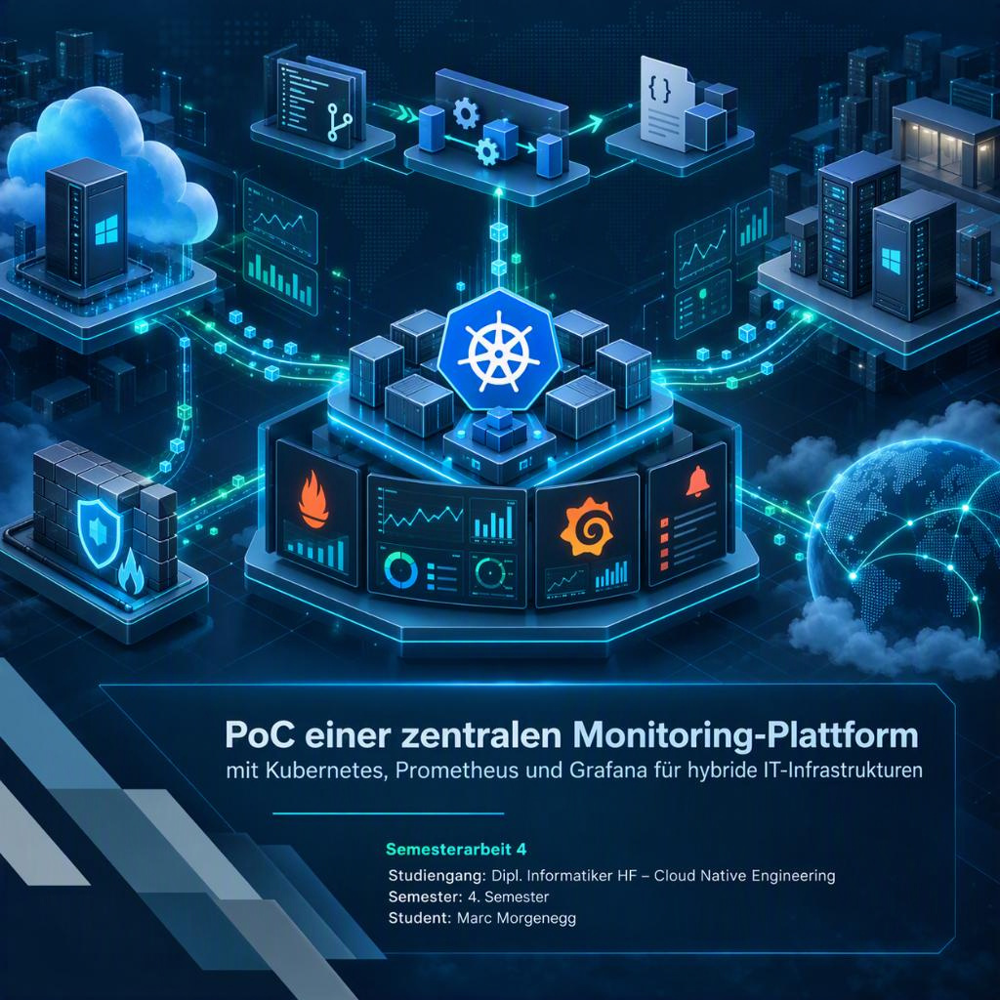

# PoC einer zentralen Monitoring-Plattform mit Kubernetes, Prometheus und Grafana für hybride IT-Infrastrukturen

---

---

## Kurzbeschreibung

Im Rahmen dieser Semesterarbeit wird ein Proof of Concept für eine zentrale, Kubernetes-basierte Monitoring-Plattform aufgebaut und evaluiert.

Als zentrale Monitoring-Komponenten werden Prometheus, Grafana und Alertmanager eingesetzt. Anhand ausgewählter Systeme aus einer hybriden IT-Infrastruktur werden verschiedene Möglichkeiten zur Erfassung, Visualisierung und Alarmierung von Monitoring-Daten untersucht.

Neben der technischen Umsetzung werden insbesondere die Reproduzierbarkeit mittels Git und Azure DevOps Pipelines, eine logische Mandantentrennung sowie die technische und wirtschaftliche Eignung der Lösung betrachtet.

Das Ergebnis der Arbeit soll als technische und wirtschaftliche Entscheidungsgrundlage für einen möglichen zukünftigen Einsatz einer solchen Monitoring-Plattform dienen.

---

## Ziele

Die wichtigsten Ziele der Semesterarbeit sind:

- Aufbau einer Kubernetes-basierten Monitoring-Plattform
- Einsatz von Prometheus, Grafana und Alertmanager
- Evaluation der Überwachung einer FortiGate Firewall
- Evaluation einer Windows Server VM in Azure
- Evaluation einer Windows Server VM On-Premises
- Integration und Test von mindestens zwei der untersuchten Zielsysteme
- Visualisierung der erfassten Metriken in Grafana
- Umsetzung und Test einer automatisierten Alarmierung
- Demonstration einer logischen Mandantentrennung
- Versionierung der Konfiguration in Git
- Reproduzierbare Bereitstellung über Azure DevOps Pipelines
- Bewertung der technischen Eignung, des Betriebsaufwands und der Wirtschaftlichkeit

---

## Projektumfang

Die Semesterarbeit wird als Minimum Viable Product, kurz MVP, umgesetzt. Der Fokus liegt auf einer funktionsfähigen und nachvollziehbaren Testumgebung und nicht auf dem Aufbau einer produktionsreifen Monitoring-Plattform.

Kundenumgebungen werden grundsätzlich konzeptionell betrachtet. Eine vollständige produktive Mandantentrennung sowie weiterführende Funktionen wie Logging und Tracing sind nicht Bestandteil des MVP.

---

## Dokumentationsstruktur

Die Dokumentation der Semesterarbeit ist in folgende Bereiche gegliedert:

1. [Projektübersicht](Seiten/01.%20Projektübersicht.md)  
   Projektmanagement, Scrumban, Projektplanung, Risikomanagement und Projektverlauf.

2. [Anforderungen und Evaluation](Seiten/02.%20Anforderungen%20%26%20Evaluation.md)  
   Anforderungen, Bewertungskriterien, Lösungsvarianten und Technologieentscheide.

3. [Architektur und Konzept](Seiten/03.%20Architektur%20%26%20Konzept.md)  
   Systemarchitektur, Netzwerk, Monitoring, Mandantentrennung und Security.

4. [Umsetzung](Seiten/04.%20Umsetzung.md)  
   Kubernetes, Prometheus, Grafana, Alertmanager und Anbindung der Zielsysteme.

5. [CI-CD und Monitoring-as-Code](Seiten/05.%20CI-CD%20%26%20Monitoring-as-Code.md)  
   Git, Azure DevOps Pipelines, Deployment und versionierte Monitoring-Konfiguration.

6. [Tests und Abnahme](Seiten/06.%20Tests%20%26%20Abnahme.md)  
   Testkonzept, Testfälle, Testergebnisse und Nachweis der Abnahmekriterien.

7. [Wirtschaftlichkeit, Fazit und Reflexion](Seiten/07.%20Wirtschaftlichkeit%2C%20Fazit%20%26%20Reflexion.md)  
   Wirtschaftliche und technische Bewertung, Zielerreichung, Reflexion und Empfehlung.

---

## Projektstatus

Der aktuelle Projektfortschritt wird über Azure Boards verwaltet.

Die technische Umsetzung und Konfiguration werden versioniert in Git geführt.

Die Projektdokumentation wird während der gesamten Semesterarbeit fortlaufend in diesem GitHub-Repository ergänzt und aktualisiert.