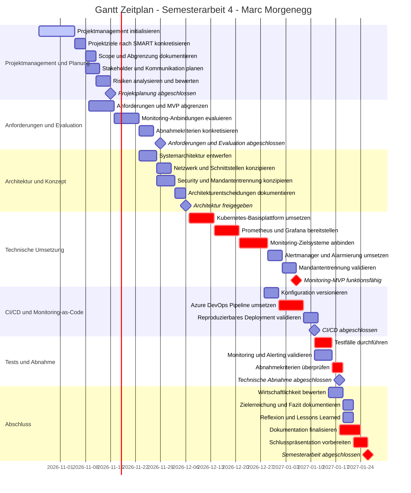

## Ausgangslage und Problemstellung

## Zielsetzung

## Projektumfang und Abgrenzung
### Must-have
### Optional
### Nicht Bestandteil des MVP

## Abnahmekriterien

## Projektmanagement
### Wahl der Projektmanagement-Methode
Für die Durchführung der Semesterarbeit wird Scrumban als Projektmanagement-Methode eingesetzt.
Scrumban verbindet Elemente aus Scrum mit dem Prinzipien von Kanban.

Die Planung erfolgt in regelmässigen Zyklen, während die eigentliche Bearbeitung der Arbeitspakete nach dem Pull-Prinzip erfolgt. Neue Arbeit wird erst begonnen, wenn im entsprechenden Arbeitsschritt freie Kapazität vorhanden ist.

Azure Boards dient zur Visualisierung und Steuerung der Arbeit. Anforderungen und Arbeitspakete werden als Work Item erfasst, priorisiert und während der Bearbeitung durch den definierten Workflow geführt.

### Warum Scrumban?
Scrumban wurde gewählt, weil das Projekt hauptsächlich durch eine einzelne Person umgesetzt wird und gleichzeitig sowohl eine strukturierte Planung als auch Flexibilität während der technischen Umsetzung erforderlich sind.

Ein klassisches Scrum-Vorgehen mit fest definierten Sprints wäre für dieses Projekt unnötig starr. Technische Arbeiten wie die Bereitstellung von Kubernetes, die Ingetration von Prometheus oder die Konfiguration von Grafana könenn Abhängigkeiten und unerwartete technische Hindernisse enthalten.

Scrumban ermöglich deshalb:
- eine priorisierte nachvollziehbare Planung,
- einen kontinuierlichen Arbeitslfuss,
- eine Begrenzung paralleler Arbeiten,
- die sichtbare Darstellung blockierter Arbeiten,
- regelmässige Überprüfung des Projektfortschritts,
- eine flexible Reaktion auf technische Erkenntnisse.

Der Projektfortschritt wird somit nicht primär anhand abgeschlossener Sprints beurteilt, sondern anhand des Arbeitsflusses, abgeschlossener Work Items, des geplanten und tatsächlichen Aufwands sowie definierter Meilensteine.

### Aufbau des Kanban-Boards
Für die Projektsteuerung wird ein Kanban-Board in Azure Boards verwendet. Die Spalten bilden den regulären Arbeitsfluss des Projekts ab. Für die aktiven Arbeitsphasen werden WIP-Limits (Work in Progress) definiert, um parallele Arbeit zu begrenzen.

| Spalte | WIP-Limit | Bedeutung |
|---|---:|---|
| `Backlog` | – | Erfasste, jedoch noch nicht zur unmittelbaren Bearbeitung eingeplante Arbeit |
| `ToDo` | 3 | Priorisierte und ausreichend vorbereitete Arbeit, die als Nächstes bearbeitet werden kann |
| `InProgress` | 1 | Aktuell aktiv bearbeitete Arbeit |
| `Review` | 1 | Fertiggestellte Arbeit, die noch geprüft werden muss |
| `Done` | – | Vollständig abgeschlossene und geprüfte Arbeit |

Der reguläre Arbeitsfluss verläuft von `Backlog` über `ToDo`, `InProgress` und `Review` nach `Done`.

Zusätzlich wird eine separate Swimlane `Blocked` verwendet. In diese Swimlane werden Work Items verschoben, deren Bearbeitung aufgrund eines Problems oder einer Abhängigkeit vorübergehend nicht fortgesetzt werden kann. Dadurch bleiben Blockierungen auf dem Board deutlich sichtbar, ohne einen zusätzlichen Schritt im regulären Workflow darzustellen.

### Workflow und Status
### Work-in-Progress und Priorisierung
### Azure Boards und Work Items
### Strukturierung des Projekts in Azure DevOps

Für die Planung und Steuerung der Semesterarbeit wird das Projekt in Azure DevOps hierarchisch in Epics und User Stories strukturiert.

Die Epics bilden die übergeordneten fachlichen und organisatorischen Bereiche der Semesterarbeit ab. Die darunterliegenden User Stories beschreiben konkrete und überprüfbare Arbeitsergebnisse.

Die User Stories werden über das Scrumban-Board priorisiert und nach dem Pull-Prinzip bearbeitet. Die Zuordnung zu Epics stellt sicher, dass die operative Projektarbeit mit den übergeordneten Projektzielen und Projektphasen verbunden bleibt.

#### Epics

| Epic | Themenbereich |
| --- | --- |
| EPIC 01 | Projektmanagement & Dokumentation |
| EPIC 02 | Anforderungen & Evaluation |
| EPIC 03 | Architektur & Konzept |
| EPIC 04 | Technische Umsetzung / Monitoring-Plattform |
| EPIC 05 | CI/CD & Monitoring-as-Code |
| EPIC 06 | Tests & Abnahme |
| EPIC 07 | Wirtschaftlichkeit, Fazit & Abschluss |

#### User Stories

Die konkrete Projektarbeit wird innerhalb der Epics in User Stories unterteilt. Für jede User Story werden die erwarteten Ergebnisse beziehungsweise Akzeptanzkriterien definiert.

Zusätzlich werden relevante Abhängigkeiten und Projektrisiken berücksichtigt. Dadurch kann vor Beginn einer Arbeit geprüft werden, ob die notwendigen Voraussetzungen erfüllt sind und wann eine User Story als abgeschlossen betrachtet werden kann.

Die User Stories bilden gleichzeitig die Grundlage für die operative Steuerung über das Scrumban-Board sowie für die spätere Nachvollziehbarkeit des Projektverlaufs.

## Projektplanung
### Zeit- und Projektplanung

Für die übergeordnete zeitliche Planung der Semesterarbeit wird ein Gantt-Diagramm verwendet. Dieses ergänzt das operative Projektmanagement mit Scrumban in Azure DevOps.

Das Gantt-Diagramm bildet die geplanten Projektphasen, Meilensteine und externen Termine über die gesamte Projektlaufzeit ab. Die konkrete Bearbeitung der einzelnen User Stories erfolgt hingegen nach dem Pull-Prinzip über das Scrumban-Board. Dadurch wird bewusst auf starre Sprints verzichtet.

Die Planung dient als Soll-Vorgabe. Der tatsächliche Projektfortschritt und der effektive Aufwand werden während der Durchführung regelmässig mit dieser Planung verglichen. Abweichungen werden im Rahmen der Projektsteuerung dokumentiert und bei Bedarf berücksichtigt.

### Zusammenhang mit Scrumban

Der Gantt-Zeitplan stellt keine Sprintplanung dar. Er definiert den zeitlichen Soll-Rahmen des Projekts und die angestrebten Meilensteine.

Die operative Steuerung erfolgt weiterhin über das Scrumban-Board in Azure DevOps. Dabei werden die priorisierten User Stories nach dem Pull-Prinzip bearbeitet. Eine neue Arbeit wird grundsätzlich erst begonnen, wenn ausreichende Kapazität gemäss den definierten WIP-Limits vorhanden ist.

Im regelmässigen Review wird geprüft, ob der tatsächliche Projektfortschritt weiterhin mit dem übergeordneten Zeitplan übereinstimmt. Bei relevanten Abweichungen werden Priorisierung, Risiken und weitere Planung überprüft.

### Arbeitspakete
### Meilensteine
### Aufwandsschätzung
### Abhängigkeiten

## Risikomanagement
### Vorgehen
### Risikobewertung
### Risikoregister
### Massnahmen und Restrisiken

## Änderungsmanagement
### Umgang mit Scope-Änderungen
### Entscheide und Abweichungen

## Projektdokumentation und Nachvollziehbarkeit