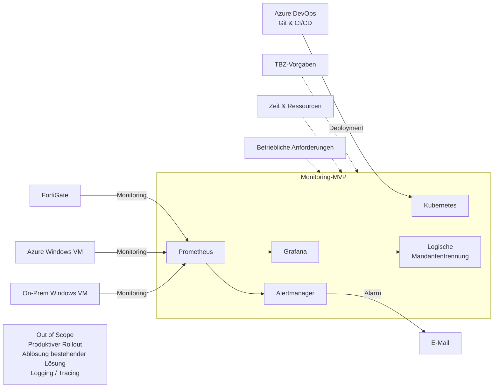
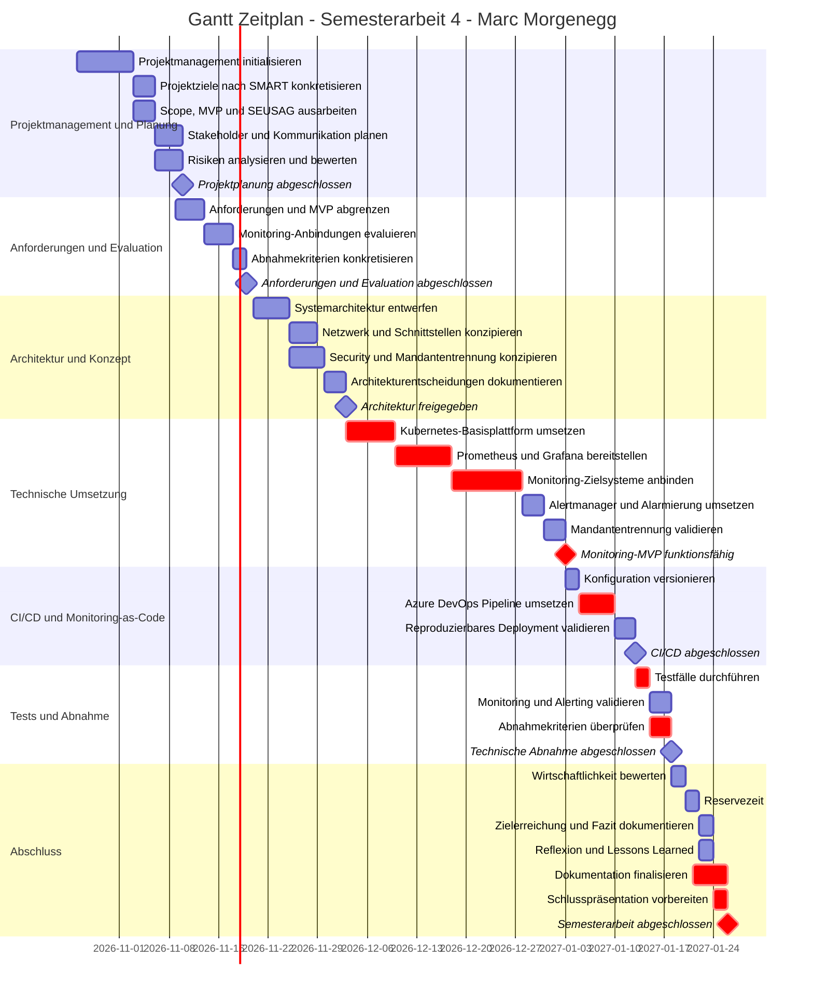

# 01. Projektübersicht

## Inhaltsverzeichnis

- [01. Projektübersicht](#01-projektübersicht)
  - [Inhaltsverzeichnis](#inhaltsverzeichnis)
  - [Ausgangslage und Zielsetzung](#ausgangslage-und-zielsetzung)
    - [SMART-Analyse](#smart-analyse)
  - [Projektumfang und Abgrenzung](#projektumfang-und-abgrenzung)
    - [Must-have](#must-have)
    - [Optional](#optional)
    - [Nicht Bestandteil des MVP](#nicht-bestandteil-des-mvp)
    - [Systemabgrenzung nach SEUSAG](#systemabgrenzung-nach-seusag)
    - [SWOT-Analyse](#swot-analyse)
  - [Abnahmekriterien](#abnahmekriterien)
  - [Projektmanagement](#projektmanagement)
    - [Scrumban und Kanban-Board](#scrumban-und-kanban-board)
    - [Priorisierung und Arbeitsfluss](#priorisierung-und-arbeitsfluss)
    - [Reviews und Kommunikation](#reviews-und-kommunikation)
    - [Azure DevOps und Work Items](#azure-devops-und-work-items)
  - [Projektplanung](#projektplanung)
    - [Zeit- und Projektplanung](#zeit--und-projektplanung)
    - [Projekt-Roadmap](#projekt-roadmap)
    - [Meilensteine](#meilensteine)
    - [Ressourcenplanung](#ressourcenplanung)
    - [Aufwandsschätzung und Soll-/Ist-Steuerung](#aufwandsschätzung-und-soll-ist-steuerung)
    - [Abhängigkeiten](#abhängigkeiten)
  - [Risikomanagement](#risikomanagement)
    - [Bewertungsmethode](#bewertungsmethode)
    - [Risikoregister](#risikoregister)
  - [`Brutto` = Risikowert vor zusätzlichen Gegenmassnahmen](#brutto--risikowert-vor-zusätzlichen-gegenmassnahmen)
  - [Änderungsmanagement](#änderungsmanagement)
  - [Projektdokumentation und Nachvollziehbarkeit](#projektdokumentation-und-nachvollziehbarkeit)

---

## Ausgangslage und Zielsetzung

Die Intecso AG setzt für die Überwachung ihrer IT-Infrastrukturen eine bestehende Monitoring-Lösung ein. Aufgrund einer erwarteten Kostensteigerung von rund 290 % zwischen 2026 und 2027 wird geprüft, ob eine alternative Monitoring-Plattform technisch und wirtschaftlich sinnvoll eingesetzt werden könnte.

Im Rahmen der Semesterarbeit wird dazu ein Kubernetes-basierter Monitoring-Ansatz mit Prometheus, Grafana und Alertmanager untersucht. Als Zielsysteme werden eine FortiGate Firewall, eine Windows Server VM in Azure sowie eine On-Premises Windows Server VM betrachtet.

Die Semesterarbeit verfolgt bewusst einen MVP-Ansatz. Ziel ist nicht die produktive Ablösung der bestehenden Monitoring-Lösung, sondern die Erstellung einer technischen und wirtschaftlichen Entscheidungsgrundlage für die zukünftige Monitoring-Strategie der Intecso AG.

### SMART-Analyse

| Kriterium | Konkretisierung |
| --- | --- |
| **S – Spezifisch** | Aufbau und Evaluation eines Kubernetes-basierten Monitoring-MVP mit Prometheus, Grafana und Alertmanager für drei definierte Zielsysteme. |
| **M – Messbar** | Evaluation aller drei Zielsysteme, Integration von mindestens zwei Systemen sowie Nachweis von Monitoring, Visualisierung, Alarmierung, Mandantentrennung und CI/CD gemäss Abnahmekriterien. |
| **A – Erreichbar** | Der Umfang ist auf einen MVP begrenzt. Die benötigten Plattformen und Testressourcen sind vorhanden beziehungsweise organisierbar. |
| **R – Relevant** | Das Projekt untersucht eine mögliche technische und wirtschaftliche Alternative zur bestehenden Monitoring-Lösung der Intecso AG. |
| **T – Terminiert** | Interner Projektabschluss bis 26.01.2027 gemäss Projektzeitplan. |

**SMART formuliertes Projektziel:**  
Bis zum 26.01.2027 wird ein Kubernetes-basiertes Monitoring-MVP aufgebaut und anhand der definierten Abnahmekriterien technisch sowie wirtschaftlich bewertet.

---

## Projektumfang und Abgrenzung

Der Projektumfang wird auf die Konzeption, Umsetzung und Bewertung eines Monitoring-MVP begrenzt. Die Abgrenzung unterscheidet zwischen verbindlichen Must-haves, optionalen Erweiterungen und expliziten Nicht-Zielen.

### Must-have

Zum verbindlichen MVP gehören:

- Kubernetes-basierte Monitoring-Plattform,
- Prometheus, Grafana und Alertmanager,
- Evaluation von FortiGate, Azure Windows VM und On-Premises Windows VM,
- Integration und Test von mindestens zwei der drei Zielsysteme,
- Visualisierung der Monitoring-Daten,
- E-Mail-Alarmierung,
- logische Mandantentrennung für mindestens zwei Mandanten,
- Monitoring-as-Code mit Git,
- automatisierte Bereitstellung über Azure DevOps,
- technische Tests und wirtschaftliche Bewertung.

### Optional

Nur bei ausreichender verfügbarer Kapazität werden umgesetzt:

- zusätzliche Zielsysteme oder Dienste,
- zusätzliche Dashboards und Alert-Regeln,
- separater Azure-Tenant oder zusätzliche Testumgebung,
- Evaluation von Logging oder Tracing,
- weiterführende Automatisierungen.

Optionale Arbeiten dürfen die Erfüllung der Must-have-Anforderungen nicht gefährden.

### Nicht Bestandteil des MVP

Nicht zum verbindlichen Projektumfang gehören:

- produktiver Kundenrollout,
- Migration oder Ablösung der bestehenden Monitoring-Lösung,
- produktive Verarbeitung von Kundendaten,
- produktionsreife Multi-Tenant-Lösung,
- vollständige technische Isolation auf Produktivniveau,
- Hochverfügbarkeits- oder Disaster-Recovery-Konzept,
- umfassende Last- und Skalierungstests,
- vollständige Betriebsorganisation eines Managed Monitoring Service.

### Systemabgrenzung nach SEUSAG

SEUSAG visualisiert die Systemgrenze des Monitoring-MVP sowie relevante Einflussgrössen, Zielsysteme und Schnittstellen.

Zum betrachteten System gehören Kubernetes, Prometheus, Grafana, Alertmanager und die logische Mandantentrennung. FortiGate sowie die Windows Server VMs in Azure und On-Premises stellen externe Zielsysteme dar.

Die technische Detailarchitektur und die konkrete Ausgestaltung der Schnittstellen werden in den späteren Evaluations- und Architekturarbeiten behandelt.

### SWOT-Analyse

| **Stärken** | **Schwächen** |
| --- | --- |
| Etablierte Open-Source-Komponenten | Höherer initialer Aufbau- und Konfigurationsaufwand |
| Versionierte Konfiguration und Monitoring-as-Code | Betrieb mehrerer Komponenten erhöht die Komplexität |
| Automatisierte Bereitstellung über Azure DevOps | Mandantentrennung im MVP nur logisch |
| Flexible Anbindung unterschiedlicher Infrastrukturtypen | Anbindungsvarianten müssen teilweise erst evaluiert werden |

| **Chancen** | **Risiken** |
| --- | --- |
| Wirtschaftliche Alternative zur bestehenden Monitoring-Lösung | Technische Probleme bei Kubernetes, CI/CD oder Zielsystemanbindungen |
| Reduktion der Herstellerabhängigkeit | Fehlende Berechtigungen oder Testumgebungen |
| Zentrale Monitoring-Basis für hybride Infrastruktur | Scope Creep durch zusätzliche Anforderungen |
| Entscheidungsgrundlage für die zukünftige Monitoring-Strategie | Höherer Betriebs- und Wartungsaufwand als erwartet |

**Fazit:**  
Der MVP soll zeigen, ob Flexibilität, Automatisierbarkeit und mögliche Kostenvorteile den zusätzlichen Implementierungs- und Betriebsaufwand rechtfertigen.

---

## Abnahmekriterien

Die Zielerreichung wird anhand der im genehmigten Projektumfang definierten Abnahmekriterien beurteilt.

**Monitoring**
- Monitoring-Anbindungen aller drei Zielsysteme sind evaluiert und dokumentiert.
- Mindestens zwei Zielsysteme sind erfolgreich integriert und getestet.
- Metriken werden in Prometheus erfasst und in Grafana visualisiert.

**Alarmierung**
- Für mindestens ein Zielsystem ist eine Alert-Regel umgesetzt.
- Ein definierter Testfall löst erfolgreich einen Alarm aus.
- Die Benachrichtigung wird über den vorgesehenen E-Mail-Kanal zugestellt.

**Mandantentrennung**
- Mindestens zwei Mandanten beziehungsweise Organisationen sind logisch getrennt.
- Mandantenspezifische Dashboards können nicht gegenseitig eingesehen werden.

**Monitoring-as-Code und CI/CD**
- Relevante Monitoring-Konfigurationen sind in Git versioniert.
- Die Bereitstellung erfolgt automatisiert über Azure DevOps.
- Die Monitoring-Plattform kann reproduzierbar bereitgestellt werden.

**Technische und wirtschaftliche Bewertung**
- Die technische Eignung des MVP wird anhand der Projektergebnisse bewertet.
- Kosten, Betriebsaufwand und relevanter Funktionsumfang werden mit der bestehenden Lösung und relevanten Alternativen verglichen.
- Aus den Ergebnissen wird eine Empfehlung für die zukünftige Monitoring-Strategie der Intecso AG abgeleitet.

Die Abnahmekriterien werden später in konkrete Testfälle und Nachweise überführt.

---

## Projektmanagement

Für die Semesterarbeit wird **Scrumban** eingesetzt. Die Methode kombiniert einen visualisierten kontinuierlichen Arbeitsfluss mit bedarfsorientierter Planung, Pull-Prinzip, WIP-Limits und regelmässigen Reviews.

Scrumban eignet sich für das Einzelprojekt, weil technische Arbeiten unterschiedliche Abhängigkeiten und Unsicherheiten enthalten und deshalb nicht sinnvoll über starre Sprints gesteuert werden müssen.

### Scrumban und Kanban-Board

Azure Boards bildet den operativen Arbeitsfluss ab:

| Status | WIP-Limit | Bedeutung |
| --- | ---: | --- |
| `Backlog` | – | Erfasste, noch nicht unmittelbar eingeplante Arbeit |
| `ToDo` | 3 | Priorisierte und ausreichend vorbereitete Arbeit |
| `InProgress` | 2 | Aktiv bearbeitete User Stories |
| `Review` | 1 | Fertig bearbeitete User Stories zur Prüfung |
| `Done` | – | Vollständig abgeschlossene und geprüfte Arbeit |

Der reguläre Arbeitsfluss verläuft von `Backlog` über `ToDo`, `InProgress` und `Review` nach `Done`.

Blockierte Arbeiten werden separat über die Swimlane `Blocked` sichtbar gemacht. Das WIP-Limit ist eine Obergrenze und kein Zielwert.

> 
>
> *Abbildung: WIP-Limits im Azure-DevOps-Kanban-Board.*

### Priorisierung und Arbeitsfluss

User Stories werden mit einer Priorität von 1 bis 4 bewertet:

| Priorität | Bedeutung |
| --- | --- |
| `1` | Kritisch für MVP, Abnahme oder Projektabschluss |
| `2` | Wichtig für die vollständige Zielerreichung |
| `3` | Sinnvolle Arbeit mittlerer Priorität |
| `4` | Optionale Erweiterung |

Neben der Priorität werden Abhängigkeiten, MVP-Relevanz, Projektfortschritt und verfügbare Kapazität berücksichtigt.

Neue Arbeit wird nach dem Pull-Prinzip begonnen. Die Spalte `ToDo` wird bedarfsorientiert aus dem `Backlog` nachgefüllt. Ein Replenishment erfolgt insbesondere, wenn weniger als zwei vorbereitete User Stories verfügbar sind oder sich Prioritäten beziehungsweise Abhängigkeiten wesentlich ändern.

### Reviews und Kommunikation

| Element | Rhythmus / Auslöser | Zweck |
| --- | --- | --- |
| User-Story-Review | vor `Done` | Akzeptanzkriterien, Ergebnisse und Nachweise prüfen |
| Projektreview mit CTO | wöchentlich | Stand, Blockaden und nächste Arbeiten besprechen |
| Statuskommunikation Dozenten | nach Arbeitstagen mit Projektfortschritt | Zwischenstand transparent kommunizieren |
| Dozentenfeedback | gemäss Planung / bei Bedarf | Projektmanagement und technische Umsetzung überprüfen |
| Gantt-Abgleich | regelmässig | Ist-Stand mit zeitlicher Soll-Planung vergleichen |

Eine User Story wird erst nach erfolgreicher Prüfung der Akzeptanzkriterien und notwendigen Nachweise nach `Done` verschoben.

Erkenntnisse aus den Reviews werden in den entsprechenden Besprechungsprotokollen festgehalten:

- [Weekly Projektreview](./Besprechungsprotokolle/Weekly_Projektreview.md)
- [Feedbacktermine Dozenten](./Besprechungsprotokolle/Feedbacktermine_Dozenten.md)

### Azure DevOps und Work Items

Das Projekt ist in Azure DevOps hierarchisch strukturiert:

| Epic | Themenbereich |
| --- | --- |
| EPIC 01 | Projektmanagement & Dokumentation |
| EPIC 02 | Anforderungen & Evaluation |
| EPIC 03 | Architektur & Konzept |
| EPIC 04 | Technische Umsetzung / Monitoring-Plattform |
| EPIC 05 | CI/CD & Monitoring-as-Code |
| EPIC 06 | Tests & Abnahme |
| EPIC 07 | Wirtschaftlichkeit, Fazit & Abschluss |

Die operative Projektarbeit wird über User Stories und bei Bedarf über untergeordnete Tasks gesteuert.

Jede User Story enthält insbesondere Akzeptanzkriterien, Priorität, Story Points sowie relevante Risiken und Abhängigkeiten. Azure DevOps ist die operative Quelle für die vollständige und aktuelle Struktur sowie den Status der Work Items.

Die GitHub-Projektdokumentation beschreibt dagegen die verwendeten Methoden, Entscheidungen und resultierenden Arbeitsergebnisse.

---

## Projektplanung

### Zeit- und Projektplanung

Der Gantt-Zeitplan bildet Projektphasen, Arbeitspakete und Meilensteine über die Projektlaufzeit ab und dient als zeitliche Soll-Planung.

Die operative Bearbeitung erfolgt weiterhin über das Scrumban-Board nach dem Pull-Prinzip. Die im Gantt dargestellte Dauer entspricht deshalb dem vorgesehenen Bearbeitungszeitraum und nicht direkt dem Arbeitsaufwand in Stunden.

Ferienzeiten sowie eine Terminreserve vor dem Projektabschluss wurden in der Planung berücksichtigt.

### Projekt-Roadmap

Die Roadmap verdichtet den Gantt-Zeitplan auf die wesentlichen Projektphasen und Zielzustände.

```mermaid
flowchart LR
    P1["Projektmanagement<br/>26.10. – 09.11."]
    P2["Anforderungen & Evaluation<br/>09.11. – 20.11."]
    P3["Architektur & Konzept<br/>20.11. – 03.12."]
    P4["Technische Umsetzung<br/>03.12. – 03.01."]
    P5["CI/CD<br/>03.01. – 13.01."]
    P6["Tests & Abnahme<br/>13.01. – 18.01."]
    P7["Abschluss<br/>18.01. – 26.01."]

    P1 --> P2 --> P3 --> P4 --> P5 --> P6 --> P7

    classDef phase fill:#dbeafe,stroke:#2563eb,color:#111827,stroke-width:2px;
    classDef implementation fill:#dcfce7,stroke:#16a34a,color:#111827,stroke-width:2px;
    classDef finish fill:#fef3c7,stroke:#d97706,color:#111827,stroke-width:2px;

    class P1,P2,P3 phase;
    class P4,P5,P6 implementation;
    class P7 finish;
```

Der interne Projektabschluss ist für den 26.01.2027 vorgesehen.

### Meilensteine

| Meilenstein | Zieltermin | Ergebnis |
| --- | --- | --- |
| **M1 – Projektplanung abgeschlossen** | gemäss Gantt | Ziele, Scope und PM-Grundlagen definiert |
| **M2 – Anforderungen und Evaluation abgeschlossen** | gemäss Gantt | MVP-Anforderungen und Monitoring-Anbindungen evaluiert |
| **M3 – Architektur freigegeben** | 03.12.2026 | Architektur-, Netzwerk- und Security-Konzepte definiert |
| **M4 – Monitoring-MVP funktionsfähig** | 03.01.2027 | Kernfunktionen technisch umgesetzt |
| **M5 – CI/CD abgeschlossen** | 13.01.2027 | Reproduzierbare Bereitstellung umgesetzt |
| **M6 – Technische Abnahme abgeschlossen** | 18.01.2027 | Technische Abnahmekriterien validiert |
| **M7 – Semesterarbeit abgeschlossen** | 26.01.2027 | Dokumentation, Bewertung, Fazit und Präsentation abgeschlossen |

### Ressourcenplanung

| Bereich | Ressourcen |
| --- | --- |
| **Personell** | Projektverantwortlicher, CTO, PM-Dozent, CNC-Dozent, interne technische Ansprechpartner |
| **Plattformen** | Kubernetes-Testumgebung, Azure DevOps, GitHub |
| **Monitoring** | Prometheus, Grafana, Alertmanager |
| **Zielsysteme** | FortiGate, Azure Windows VM, On-Premises Windows VM |
| **Werkzeuge** | Git, kubectl, Helm, Azure CLI, Visual Studio Code |
| **Rahmenbedingungen** | Berechtigungen, Netzwerkzugriff, Testsysteme, E-Mail-Testmöglichkeit und Projektzeit |

Die Verfügbarkeit notwendiger Ressourcen wird vor beziehungsweise während der entsprechenden Projektphase geprüft. Fehlende Ressourcen oder Zugriffe werden als Blockade beziehungsweise Projektrisiko behandelt.

### Aufwandsschätzung und Soll-/Ist-Steuerung

User Stories werden relativ mit der Fibonacci-Skala `1, 2, 3, 5, 8, 13` geschätzt. Berücksichtigt werden Umfang, Komplexität, Unsicherheit und Abhängigkeiten.

| Story Points | Einordnung |
| ---: | --- |
| `1–2` | klein und überschaubar |
| `3` | klein bis mittel |
| `5` | mittel |
| `8` | gross beziehungsweise technisch anspruchsvoll |
| `13` | sehr gross; Aufteilung prüfen |

Story Points sind keine Zeiteinheiten. Die tatsächliche Projektzeit wird separat erfasst.

> 
>
> *Abbildung: Fibonacci-Aufwandsschätzung in Azure DevOps.*

Zur zeitlichen Aufwandsteuerung wird der geplante Aufwand dem tatsächlich geleisteten Aufwand gegenübergestellt:

| Arbeitspaket | Soll | Ist | Abweichung |
| --- | ---: | ---: | ---: |
| Analyse & Anforderungen | 6 h | – | – |
| Architektur & Konzept | 6 h | – | – |
| Kubernetes-Plattform | 7 h | – | – |
| Prometheus & Grafana | 8 h | – | – |
| Alertmanager | 5 h | – | – |
| Mandantentrennung | 4 h | – | – |
| CI/CD-Pipeline | 4 h | – | – |
| Tests & Abnahme | 3 h | – | – |
| Wirtschaftlichkeitsvergleich | 2 h | – | – |
| Dokumentation | 3 h | – | – |
| Reserve | 2 h | – | – |
| **Total** | **50 h** | **–** | **–** |

`Abweichung = Ist-Aufwand - Soll-Aufwand`

Bei relevanten Abweichungen werden Ursache, Restaufwand, verfügbare Reserve sowie Auswirkungen auf Scope und Termine geprüft. Must-have-Anforderungen haben Vorrang vor optionalen Erweiterungen.

### Abhängigkeiten

| Phase | Abhängig von |
| --- | --- |
| Anforderungen & Evaluation | Projektziele und MVP-Scope |
| Architektur & Konzept | Anforderungen und Evaluation |
| Technische Umsetzung | Architektur und technische Konzepte |
| CI/CD | realisierte Monitoring-Plattform |
| Tests & Abnahme | technische Umsetzung und CI/CD |
| Abschluss | Testergebnisse und Abnahmenachweise |

Detailabhängigkeiten zwischen User Stories werden in Azure DevOps gepflegt. Parallele Arbeiten bleiben möglich, sofern keine fachliche Abhängigkeit besteht und die definierten WIP-Limits eingehalten werden.

---

## Risikomanagement
Das Risikomanagement dient dazu, mögliche zukünftige Ereignisse frühzeitig zu erkennen, zu bewerten und geeignete Gegenmassnahmen festzulegen.

Ein Risiko unterscheidet sich von einem Problem dadurch, dass das Risiko noch nicht eingetreten ist. Ein bereits eingetretenes Ereignis wird als Problem beziehungsweise Blockade behandelt und nicht mehr als zukünftiges Risiko bewertet.

Risiken werden nach folgendem Schema beschrieben:

> **Aufgrund von [Ursache] könnte [Ereignis] eintreten, was zu [Auswirkung] führt.**

Für jedes Risiko werden sowohl das Bruttorisiko vor der Umsetzung von Gegenmassnahmen als auch das verbleibende Nettorisiko beziehungsweise Restrisiko nach den Gegenmassnahmen bewertet.

### Bewertungsmethode

Die Bewertung erfolgt anhand von Eintrittswahrscheinlichkeit und Auswirkung.

| Wert | Eintrittswahrscheinlichkeit | Auswirkung |
| ---: | --- | --- |
| `1` | Niedrig (< 30 %) | Gering – Auswirkungen sind mit geringem Aufwand beherrschbar |
| `2` | Mittel (30–70 %) | Erheblich – relevanter Einfluss auf Aufwand oder Termine |
| `3` | Hoch (> 70 %) | Kritisch – Projektziele, MVP oder Projektabschluss können gefährdet werden |

Der Risikowert wird berechnet als:

`Risikowert = Eintrittswahrscheinlichkeit × Auswirkung`

Daraus ergeben sich Risikowerte zwischen `1` und `9`.

| Risikowert | Bewertung | Umgang |
| ---: | --- | --- |
| `1–2` | Niedrig | beobachten |
| `3–4` | Mittel | Massnahme prüfen beziehungsweise umsetzen |
| `6` | Hoch | Gegenmassnahme erforderlich |
| `9` | Kritisch | unmittelbar behandeln |

Nach Definition und Umsetzung einer Gegenmassnahme werden Eintrittswahrscheinlichkeit und Auswirkung erneut bewertet. Dadurch wird das verbleibende Netto- beziehungsweise Restrisiko bestimmt.

Die Risiken werden während des Projektverlaufs regelmässig überprüft. Änderungen der Bewertung, neu identifizierte Risiken und eingetretene Probleme werden entsprechend nachgeführt.

### Risikoregister
Das Risikoregister enthält die für die Semesterarbeit identifizierten Projektrisiken. Jedes Risiko wird anhand von Ursache, möglichem Ereignis und Auswirkung beschrieben.

Die initiale Bewertung stellt das Bruttorisiko dar. Dabei wird das Risiko ohne Berücksichtigung zusätzlicher Gegenmassnahmen bewertet.

| ID | Risiko | Ursache | Mögliches Ereignis | Auswirkung | W | A | Brutto |
| --- | --- | --- | --- | --- | :---: | :---: | :---: |
| R01 | Zu grosser Projektumfang | Zusätzliche technische Anforderungen oder interessante Erweiterungsmöglichkeiten entstehen während des Projekts. | Der definierte MVP wird um weitere Funktionen oder Zielsysteme erweitert. | Der geplante Aufwand steigt und wichtige Must-have-Arbeiten oder Termine können gefährdet werden. | 2 | 3 | **6** |
| R02 | Fehlende Berechtigungen oder Testumgebungen | Benötigte Zugriffe oder geeignete Testressourcen stehen nicht rechtzeitig zur Verfügung. | Notwendige Systeme können nicht wie geplant analysiert oder angebunden werden. | Evaluation und technische Umsetzung verzögern sich oder müssen eingeschränkt werden. | 2 | 3 | **6** |
| R03 | Verzögerte Anbindung interner Systeme | Technische oder organisatorische Abhängigkeiten erschweren den Zugriff auf interne Zielsysteme. | Ein oder mehrere Zielsysteme können nicht zum geplanten Zeitpunkt angebunden werden. | Nachfolgende Umsetzungs- und Testarbeiten verzögern sich. | 2 | 2 | **4** |
| R04 | Probleme mit Kubernetes oder CI/CD | Die eingesetzten Technologien und Integrationen besitzen technische Abhängigkeiten und teilweise erhöhte Komplexität. | Kubernetes-Komponenten oder die Azure DevOps Pipeline funktionieren nicht wie vorgesehen. | Umsetzung, reproduzierbare Bereitstellung oder Abnahmekriterien können verzögert beziehungsweise gefährdet werden. | 2 | 3 | **6** |
| R05 | Höherer Ressourcenbedarf als erwartet | Monitoring-Komponenten benötigen mehr Rechenleistung, Speicher oder Speicherkapazität als geplant. | Die vorhandene Testumgebung reicht für den vorgesehenen MVP nicht aus. | Zusätzliche Optimierungen oder Einschränkungen des MVP werden notwendig. | 2 | 2 | **4** |
| R06 | Eingeschränkte Mandantenfähigkeit | Die gewählten Open-Source-Komponenten unterstützen die benötigte Mandantentrennung nur eingeschränkt. | Die geplante logische Trennung von mindestens zwei Mandanten kann nicht wie vorgesehen umgesetzt werden. | Ein wesentliches Abnahmekriterium kann nur eingeschränkt erfüllt werden. | 2 | 3 | **6** |
| R07 | Sicherheits- und Datenschutzrisiken | Monitoring benötigt Zugriffe auf Systeme und verarbeitet technische Infrastrukturinformationen. | Zu weitreichende Berechtigungen oder ungeeignete Daten gelangen in die Testumgebung. | Sicherheits- oder Datenschutzanforderungen können verletzt werden. | 2 | 3 | **6** |
| R08 | Eingeschränkter Vergleich mit Alternativlösungen | Für bestehende oder alternative Monitoring-Lösungen stehen nicht alle Kosten-, Betriebs- oder Funktionsdaten zur Verfügung. | Lösungen können nur teilweise miteinander verglichen werden. | Die wirtschaftliche Bewertung und Empfehlung besitzt eine eingeschränkte Aussagekraft. | 2 | 2 | **4** |
| R09 | Externe Testanbindung nicht verfügbar | Externe beziehungsweise zusätzliche Testsysteme oder Netzwerke stehen nicht rechtzeitig zur Verfügung. | Eine geplante zusätzliche externe Anbindung kann nicht praktisch validiert werden. | Die externe Validierung entfällt und kann nur konzeptionell betrachtet werden. | 2 | 1 | **2** |

**Legende:**  
`W` = Eintrittswahrscheinlichkeit  
`A` = Auswirkung  
`Brutto` = Risikowert vor zusätzlichen Gegenmassnahmen
---

## Änderungsmanagement

Änderungen am definierten Projektumfang werden vor ihrer Umsetzung hinsichtlich Auswirkungen auf Projektziele, Aufwand, Termine, Risiken und Abnahmekriterien beurteilt.

Neue Anforderungen werden nicht automatisch in den MVP übernommen. Zunächst wird geprüft, ob sie für die vorhandenen Abnahmekriterien notwendig sind oder als optionale Erweiterung behandelt werden können.

Relevante Scope-Änderungen werden mit Begründung, Auswirkung und Entscheid dokumentiert. Wesentliche Änderungen der genehmigten Aufgabenstellung werden mit den zuständigen Experten abgestimmt.

Projektentscheide und relevante Planabweichungen werden im weiteren Verlauf nachvollziehbar dokumentiert.

---

## Projektdokumentation und Nachvollziehbarkeit

Die Projektdokumentation wird laufend parallel zur Projektarbeit im GitHub-Repository gepflegt und über fokussierte Commits versioniert.

Azure DevOps dient als operative Quelle für:

- Backlog und Work Items,
- Prioritäten und Story Points,
- aktuellen Scrumban-Status,
- Aufgaben und Abhängigkeiten.

Das GitHub-Repository dient als dokumentarische Quelle für:

- Projektmanagement-Methoden und Planungsartefakte,
- technische Konzepte und Evaluationen,
- Architekturentscheidungen,
- Umsetzung und Konfiguration,
- Test- und Abnahmenachweise,
- Wirtschaftlichkeitsbewertung,
- Fazit und Reflexion.

Relevante Ergebnisse und Entscheidungen werden möglichst im Zusammenhang mit der jeweiligen Projektarbeit dokumentiert. Dadurch bleibt der Projektverlauf für die begleitenden Experten nachvollziehbar.