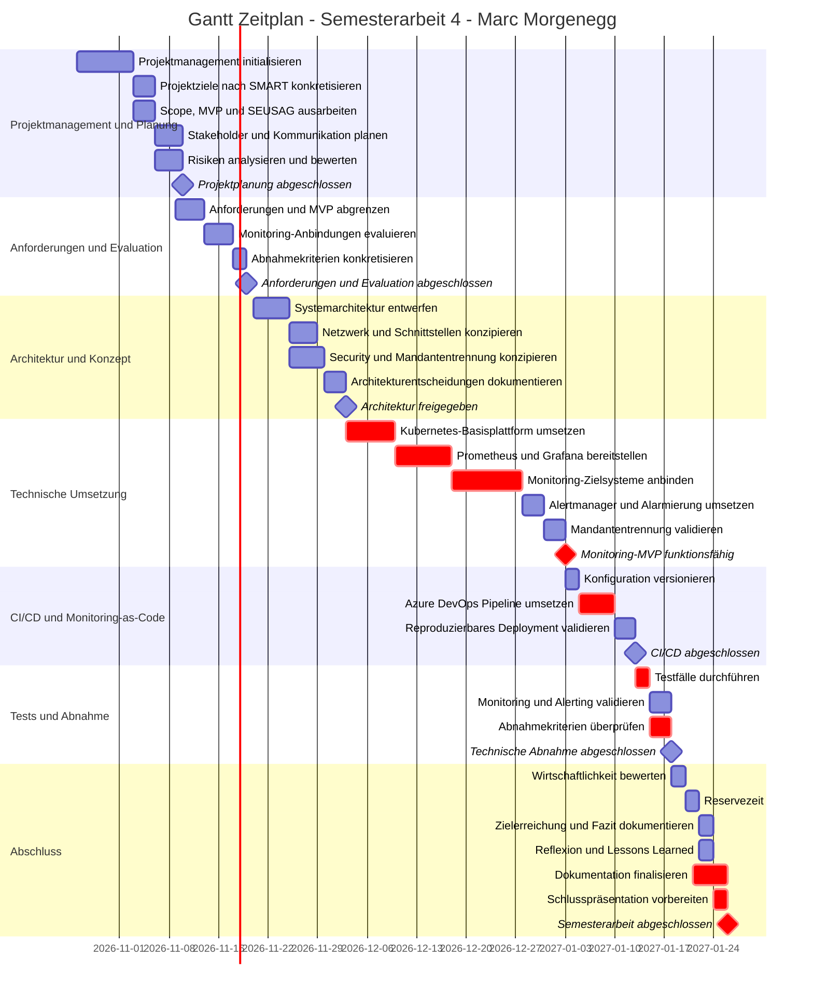
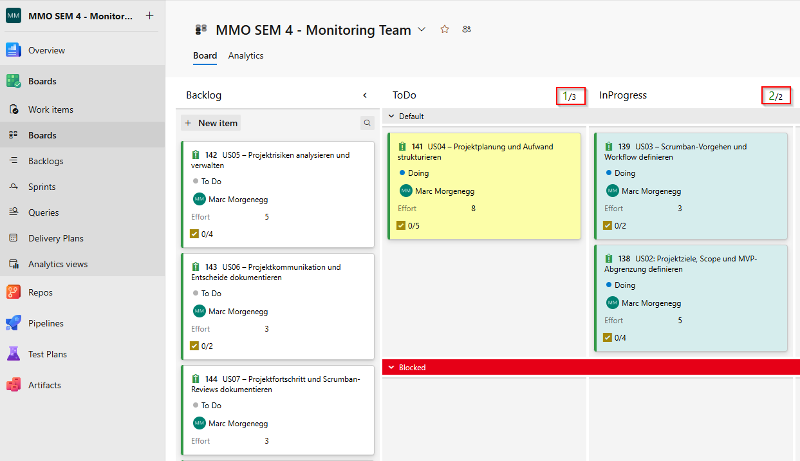

# 01. Projektübersicht
## Inhaltsverzeichnis

- [01. Projektübersicht](#01-projektübersicht)
  - [Inhaltsverzeichnis](#inhaltsverzeichnis)
  - [Ausgangslage und Problemstellung](#ausgangslage-und-problemstellung)
  - [Zielsetzung](#zielsetzung)
    - [SMART-Analyse](#smart-analyse)
  - [Projektumfang und Abgrenzung](#projektumfang-und-abgrenzung)
    - [Must-have](#must-have)
    - [Optional](#optional)
    - [Nicht Bestandteil des MVP](#nicht-bestandteil-des-mvp)
  - [Abnahmekriterien](#abnahmekriterien)
  - [Projektmanagement](#projektmanagement)
    - [Wahl der Projektmanagement-Methode](#wahl-der-projektmanagement-methode)
    - [Warum Scrumban?](#warum-scrumban)
    - [Aufbau des Kanban-Boards](#aufbau-des-kanban-boards)
    - [Workflow und Status](#workflow-und-status)
    - [Work-in-Progress und Priorisierung](#work-in-progress-und-priorisierung)
      - [Work-in-Progress-Limits](#work-in-progress-limits)
      - [Priorisierung](#priorisierung)
      - [Replenishment](#replenishment)
      - [Reviews](#reviews)
        - [Review von User Stories](#review-von-user-stories)
        - [Wöchentlicher Projektreview](#wöchentlicher-projektreview)
        - [Statuskommunikation mit den Dozenten](#statuskommunikation-mit-den-dozenten)
        - [Feedbacktermine mit den Dozenten](#feedbacktermine-mit-den-dozenten)
      - [Scrumban-Cadence und Zeitsteuerung](#scrumban-cadence-und-zeitsteuerung)
    - [Azure Boards und Work Items](#azure-boards-und-work-items)
    - [Strukturierung des Projekts in Azure DevOps](#strukturierung-des-projekts-in-azure-devops)
      - [Epics](#epics)
      - [User Stories](#user-stories)
        - [Übersicht der User Stories](#übersicht-der-user-stories)
      - [Tasks](#tasks)
  - [Projektplanung](#projektplanung)
    - [Zeit- und Projektplanung](#zeit--und-projektplanung)
    - [Zusammenhang mit Scrumban](#zusammenhang-mit-scrumban)
    - [Arbeitspakete](#arbeitspakete)
    - [Meilensteine](#meilensteine)
    - [Aufwandsschätzung](#aufwandsschätzung)
      - [Fibonacci-Skala und Bewertungskriterien](#fibonacci-skala-und-bewertungskriterien)
      - [Geplanter Arbeitsaufwand](#geplanter-arbeitsaufwand)
    - [Abhängigkeiten](#abhängigkeiten)
  - [Risikomanagement](#risikomanagement)
    - [Vorgehen](#vorgehen)
    - [Risikobewertung](#risikobewertung)
    - [Risikoregister](#risikoregister)
    - [Massnahmen und Restrisiken](#massnahmen-und-restrisiken)
  - [Änderungsmanagement](#änderungsmanagement)
    - [Umgang mit Scope-Änderungen](#umgang-mit-scope-änderungen)
    - [Entscheide und Abweichungen](#entscheide-und-abweichungen)
  - [Projektdokumentation und Nachvollziehbarkeit](#projektdokumentation-und-nachvollziehbarkeit)
---

## Ausgangslage und Problemstellung

## Zielsetzung

### SMART-Analyse
Die Projektziele werden mit der SMART-Methode konkretisiert. Dadurch wird geprüft, ob die Zielsetzung spezifisch, messbar, erreichbar, relevant und terminiert formuliert ist.

| SMART-Kriterium | Konkretisierung |
| --- | --- |
| **S – Spezifisch** | Im Rahmen der Semesterarbeit wird ein MVP einer zentralen Kubernetes-basierten Monitoring-Plattform mit Prometheus, Grafana und Alertmanager aufgebaut. Für eine FortiGate Firewall, eine Windows Server VM in Azure sowie eine On-Premises Windows Server VM werden geeignete Monitoring-Anbindungen evaluiert. Mindestens zwei dieser Zielsysteme werden technisch integriert. Zusätzlich werden Alarmierung, logische Mandantentrennung sowie eine automatisierte Bereitstellung über Git und Azure DevOps umgesetzt und validiert. |
| **M – Messbar** | Die Zielerreichung wird anhand der definierten Abnahmekriterien überprüft. Die Anbindungsvarianten aller drei Zielsysteme werden evaluiert und dokumentiert. Mindestens zwei Zielsysteme müssen erfolgreich integriert und getestet werden. Für erfolgreich angebundene Systeme werden Metriken in Prometheus erfasst und in Grafana visualisiert. Mindestens eine Alert-Regel wird mittels definiertem Testfall erfolgreich ausgelöst und über den vorgesehenen Kanal zugestellt. Mindestens zwei Mandanten beziehungsweise Organisationen werden logisch getrennt und der gegenseitige Zugriff auf deren Dashboards verhindert. Die Monitoring-Plattform muss reproduzierbar über Git und eine Azure DevOps Pipeline bereitgestellt werden können. Abschliessend erfolgt ein technischer und wirtschaftlicher Vergleich mit der bestehenden Monitoring-Lösung und relevanten Alternativen. |
| **A – Erreichbar** | Das Ziel ist innerhalb der Semesterarbeit erreichbar, da der Umfang bewusst auf einen MVP begrenzt wird. Die benötigten Komponenten und Werkzeuge wie Kubernetes, Azure DevOps, Prometheus, Grafana und Alertmanager sowie interne Testsysteme sind vorhanden oder organisierbar. Für die praktische Umsetzung müssen nicht alle evaluierten Zielsysteme erfolgreich integriert werden; als Mindestziel sind zwei erfolgreiche Integrationen definiert. Erweiterungen ausserhalb des MVP werden nur umgesetzt, wenn ausreichend Zeit zur Verfügung steht. |
| **R – Relevant** | Das Projekt behandelt eine konkrete betriebliche Fragestellung der Intecso AG. Aufgrund der erwarteten Kostenentwicklung der bestehenden Monitoring-Lösung soll geprüft werden, ob eine Kubernetes-basierte Open-Source-Lösung technisch und wirtschaftlich als zukünftige Monitoring-Plattform geeignet sein könnte. Gleichzeitig verbindet das Projekt die für die Semesterarbeit relevanten Themen Cloud Native, Kubernetes, Monitoring, DevOps und CI/CD. |
| **T – Terminiert** | Das Monitoring-MVP, die technische Validierung, der Wirtschaftlichkeitsvergleich und die zugehörige Projektdokumentation werden innerhalb des definierten Zeitraums der Semesterarbeit umgesetzt. Der interne Projektzeitplan sieht den Abschluss bis zum 26.01.2027 vor. Damit verbleibt vor der offiziellen Abgabe beziehungsweise Abnahme ein zeitlicher Puffer. Die einzelnen Projektphasen und Meilensteine werden über den dokumentierten Gantt-Zeitplan gesteuert. |

**SMART formuliertes Projektziel:**  
Bis zum geplanten Projektabschluss am 26.01.2027 wird ein Kubernetes-basiertes Monitoring-MVP mit Prometheus, Grafana und Alertmanager aufgebaut, für alle drei definierten Zielsysteme werden geeignete Monitoring-Anbindungen evaluiert und mindestens zwei davon technisch integriert und getestet. Die Lösung weist funktionierende Metrikerfassung und Visualisierung, eine getestete Alarmierung, die logische Trennung von mindestens zwei Mandanten sowie eine reproduzierbare Bereitstellung über Git und Azure DevOps nach und wird anschliessend hinsichtlich technischer Eignung, Betriebsaufwand und Wirtschaftlichkeit bewertet.

## Projektumfang und Abgrenzung
Der Projektumfang wird bewusst auf die Konzeption, Umsetzung und Bewertung eines Monitoring-MVP begrenzt. Ziel ist nicht der Aufbau einer vollständig produktionsreifen Monitoring-Plattform, sondern der technische und wirtschaftliche Nachweis, ob der gewählte Lösungsansatz grundsätzlich für einen zukünftigen Einsatz geeignet ist.

Die Abgrenzung unterscheidet zwischen verbindlichen Must-have-Bestandteilen, optionalen Erweiterungen und ausdrücklich nicht zum MVP gehörenden Anforderungen.

Diese Abgrenzung dient gleichzeitig als Basis für die Priorisierung des Backlogs. Zusätzliche Funktionen dürfen erst berücksichtigt werden, wenn die für das MVP notwendigen Arbeiten nicht gefährdet werden.

### Must-have
Folgende Bestandteile gehören verbindlich zum Projektumfang:

- Monitoring-Plattform
  - Aufbau einer Kubernetes-basierten Monitoring-Plattform.
  - Bereitstellung von Prometheus zur Erfassung von Monitoring-Metriken.
  - Bereitstellung von Grafana zur Visualisierung der Monitoring-Daten.
  - Bereitstellung von Alertmanager zur Verarbeitung von Alarmen.

- Monitoring-Zielsysteme
  - Für folgende drei Zielsysteme werden geeignete Monitoring- beziehungsweise Anbindungsvarianten untersucht und dokumentiert:

    - FortiGate Firewall,
    - Windows Server VM in Azure,
    - Windows Server VM On-Premises.

Mindestens zwei dieser drei Zielsysteme werden im Rahmen des MVP erfolgreich integriert und getestet.
Für erfolgreich integrierte Systeme werden relevante Metriken in Prometheus erfasst und in Grafana visualisiert.

- Alarmierung
  - Für mindestens ein integriertes Zielsystem wird eine geeignete Alert-Regel umgesetzt.
  - Die Alarmierung wird anhand eines definierten Testfalls überprüft.
  - Eine ausgelöste Benachrichtigung wird über den vorgesehenen E-Mail-Kanal zugestellt.

- Mandantentrennung
  - Mindestens zwei Mandanten beziehungsweise Organisationen werden innerhalb der Monitoring-Plattform logisch voneinander getrennt.
  - Mandantenspezifische Monitoring-Inhalte beziehungsweise Dashboards werden voneinander abgegrenzt.
  - Benutzer eines Mandanten dürfen nicht auf die Dashboards des anderen Mandanten zugreifen können.

- Monitoring-as-Code und CI/CD
  - Die für das MVP relevanten Monitoring-Konfigurationen werden soweit sinnvoll versioniert.
  - Das technische Repository wird in Azure DevOps geführt.
  - Mindestens eine Azure DevOps Pipeline wird für die automatisierte Bereitstellung eingesetzt.
  - Die Monitoring-Plattform muss auf Basis der versionierten Konfiguration reproduzierbar bereitgestellt werden können.

- Tests und Bewertung
  - Die definierten technischen Abnahmekriterien werden anhand geeigneter Testfälle überprüft.
  - Testergebnisse, Einschränkungen und Abweichungen werden dokumentiert.
  - Die technische Eignung der untersuchten Monitoring-Lösung wird bewertet.
  - Die Lösung wird hinsichtlich Kosten, Betriebsaufwand und relevantem Funktionsumfang mit der bestehenden Monitoring-Lösung und verfügbaren Alternativen verglichen.
  - Aus den Ergebnissen wird eine Entscheidungsgrundlage für die zukünftige Monitoring-Strategie der Intecso AG abgeleitet.

### Optional
Optionale Arbeiten werden nur umgesetzt, wenn die Must-have-Anforderungen ausreichend abgesichert sind und genügend Projektzeit verfügbar ist.

Folgende Erweiterungen gelten als optional:

- Anbindung weiterer Systeme oder Dienste über die drei definierten Zielsysteme hinaus.
- Erweiterung der Grafana-Dashboards über die für den Funktionsnachweis notwendigen Visualisierungen hinaus.
- Umsetzung zusätzlicher Alert-Regeln.
- Anbindung eines separaten Azure-Tenants.
- Verwendung eines separaten Testnetzwerks beziehungsweise einer zusätzlichen Testumgebung.
- Evaluation zusätzlicher Observability-Komponenten für Logging oder Tracing.
- Weiterführende Automatisierungen über die für den MVP benötigte CI/CD-Bereitstellung hinaus.
- Weiterführende technische Optimierungen, sofern sie für die Erfüllung der Abnahmekriterien nicht erforderlich sind.

Optionale Arbeiten werden im Backlog entsprechend tiefer priorisiert und dürfen den geplanten Abschluss der Must-have-Anforderungen nicht gefährden.

### Nicht Bestandteil des MVP
Folgende Punkte gehören ausdrücklich nicht zum verbindlichen Projektumfang:

- produktiver Rollout der Monitoring-Plattform bei Kunden,
- Migration der bestehenden produktiven Monitoring-Lösung,
- Ablösung der bestehenden Monitoring-Lösung im Rahmen der Semesterarbeit,
- produktive Überwachung von Kundendaten oder produktiven Kundenumgebungen,
- Aufbau einer vollständig produktionsreifen Multi-Tenant-Plattform,
- vollständige technische Isolation von Kundenumgebungen auf Produktivniveau,
- Hochverfügbarkeits- oder Disaster-Recovery-Konzept für einen späteren Produktivbetrieb,
- umfassende Performance-, Last- oder Skalierungstests,
- vollständige Betriebsorganisation für einen zukünftigen Managed Monitoring Service,
- Einführung zusätzlicher Observability-Bereiche wie Logging oder Tracing als verpflichtender Bestandteil,
- produktive Einführung der im Projekt resultierenden Empfehlung.

Das Ergebnis der Semesterarbeit ist damit ein validierter MVP beziehungsweise Proof of Concept und eine technische sowie wirtschaftliche Entscheidungsgrundlage. Ein allfälliger produktiver Ausbau oder Rollout erfolgt ausserhalb dieser Semesterarbeit.

## Abnahmekriterien

## Projektmanagement
### Wahl der Projektmanagement-Methode
Für die Durchführung der Semesterarbeit wird Scrumban als Projektmanagement-Methode eingesetzt.
Scrumban verbindet Elemente aus Scrum mit den Prinzipien von Kanban.

Die Planung erfolgt in regelmässigen Zyklen, während die eigentliche Bearbeitung der Arbeitspakete nach dem Pull-Prinzip erfolgt. Neue Arbeit wird erst begonnen, wenn im entsprechenden Arbeitsschritt freie Kapazität vorhanden ist.

Azure Boards dient zur Visualisierung und Steuerung der Arbeit. Anforderungen und Arbeitspakete werden als Work Items erfasst, priorisiert und während der Bearbeitung durch den definierten Workflow geführt.

### Warum Scrumban?
Scrumban wurde gewählt, weil das Projekt hauptsächlich durch eine einzelne Person umgesetzt wird und gleichzeitig sowohl eine strukturierte Planung als auch Flexibilität während der technischen Umsetzung erforderlich sind.

Ein klassisches Scrum-Vorgehen mit fest definierten Sprints wäre für dieses Projekt unnötig starr. Technische Arbeiten wie die Bereitstellung von Kubernetes, die Integration von Prometheus oder die Konfiguration von Grafana können Abhängigkeiten und unerwartete technische Hindernisse enthalten.

Scrumban ermöglicht deshalb:
- eine priorisierte nachvollziehbare Planung,
- einen kontinuierlichen Arbeitsfluss,
- eine Begrenzung paralleler Arbeiten,
- die sichtbare Darstellung blockierter Arbeiten,
- regelmässige Überprüfung des Projektfortschritts,
- eine flexible Reaktion auf technische Erkenntnisse.

Der Projektfortschritt wird somit nicht primär anhand abgeschlossener Sprints beurteilt, sondern anhand des Arbeitsflusses, abgeschlossener Work Items, des geplanten und tatsächlichen Aufwands sowie definierter Meilensteine.

### Aufbau des Kanban-Boards
Für die Projektsteuerung wird ein Kanban-Board in Azure Boards verwendet. Die Spalten bilden den regulären Arbeitsfluss des Projekts ab. Für die aktiven Arbeitsphasen werden WIP-Limits (Work in Progress) definiert, um parallele Arbeit zu begrenzen.

| Spalte | WIP-Limit | Bedeutung |
|---|---:|---|
| `Backlog` | – | Erfasste, jedoch noch nicht zur unmittelbaren Bearbeitung eingeplante Arbeit |
| `ToDo` | 3 | Priorisierte und ausreichend vorbereitete Arbeit, die als Nächstes bearbeitet werden kann |
| `InProgress` | 2 | Aktuell aktiv bearbeitete Arbeit |
| `Review` | 1 | Fertiggestellte Arbeit, die noch geprüft werden muss |
| `Done` | – | Vollständig abgeschlossene und geprüfte Arbeit |

Der reguläre Arbeitsfluss verläuft von `Backlog` über `ToDo`, `InProgress` und `Review` nach `Done`.

Zusätzlich wird eine separate Swimlane `Blocked` verwendet. In diese Swimlane werden Work Items verschoben, deren Bearbeitung aufgrund eines Problems oder einer Abhängigkeit vorübergehend nicht fortgesetzt werden kann. Dadurch bleiben Blockierungen auf dem Board deutlich sichtbar, ohne einen zusätzlichen Schritt im regulären Workflow darzustellen.

### Workflow und Status
### Work-in-Progress und Priorisierung
#### Work-in-Progress-Limits
Um zu viele parallel begonnene Arbeiten zu vermeiden, werden für die aktiven Bereiche des Kanban-Boards Work-in-Progress-Limits (WIP-Limits) verwendet.

Für das Projekt gelten folgende WIP-Limits:

| Spalte | WIP-Limit |
| --- | ---: |
| `ToDo` | 3 |
| `InProgress` | 2 |
| `Review` | 1 |

Das WIP-Limit stellt eine Obergrenze und keinen Zielwert dar. Es müssen somit nicht jederzeit zwei User Stories gleichzeitig bearbeitet werden.

Das Limit von zwei User Stories in `InProgress` ermöglicht es, bei Bedarf zwei fachlich zusammenhängende Arbeiten parallel weiterzuführen. Dies ist insbesondere dann sinnvoll, wenn eine übergeordnete oder länger laufende User Story parallel zu einem konkreten Arbeitspaket bearbeitet wird.

Eine weitere User Story wird nur nach `InProgress` gezogen, wenn innerhalb des definierten WIP-Limits freie Kapazität vorhanden ist und die parallele Bearbeitung fachlich sinnvoll ist. Dadurch soll verhindert werden, dass zu viele Arbeiten gleichzeitig begonnen werden und sich deren Abschluss unnötig verzögert.

Die Projektdokumentation wird parallel zur jeweiligen Projektarbeit fortgeführt. Relevante Entscheidungen, Ergebnisse, Erkenntnisse und Nachweise werden möglichst im Zusammenhang mit der bearbeiteten User Story dokumentiert und nicht gesammelt am Ende des Projekts nachgeführt.

Blockierte Arbeiten werden separat über die Swimlane `Blocked` sichtbar gemacht. Eine Blockierung erweitert das definierte WIP-Limit nicht automatisch. Stattdessen wird geprüft, ob eine andere unabhängige und priorisierte Arbeit innerhalb der verfügbaren Kapazität sinnvoll weiterbearbeitet werden kann.

> 
> 
> *Abbildung: WIP-Limite in AzureDevops Kanban Board*

#### Priorisierung 
Die User Stories werden in Azure DevOps mit einer Priorität von 1 bis 4 bewertet. Die Priorität dient dazu, bei der Auswahl der nächsten Arbeit deren Bedeutung für den MVP, die Projektziele und bestehende Abhängigkeiten zu berücksichtigen.

| Priorität | Bedeutung |
| --- | --- |
| `1` | Kritische beziehungsweise für MVP, Abnahme oder Projektabschluss notwendige Arbeit. |
| `2` | Wichtige Arbeit zur vollständigen Zielerreichung oder zur Unterstützung der Must-have-Anforderungen. |
| `3` | Sinnvolle Arbeit mit mittlerer Priorität, die nach höher priorisierten Arbeiten berücksichtigt wird. |
| `4` | Optionale Erweiterung, die nur bei ausreichender verfügbarer Kapazität bearbeitet wird. |

Die Priorität wird nicht isoliert betrachtet. Vor dem Nachziehen einer User Story werden zusätzlich bestehende Abhängigkeiten, der aktuelle Projektstand und die verfügbare Kapazität berücksichtigt.

Aufgaben mit tieferer Priorität dürfen die Umsetzung der definierten Must-have-Anforderungen nicht gefährden.

#### Replenishment
Das Replenishment beschreibt das bedarfsorientierte Nachfüllen der Spalte `ToDo` mit ausreichend vorbereiteten User Stories aus dem `Backlog`.

Im Projekt wird bewusst auf eine fixe Sprintplanung verzichtet. Stattdessen wird regelmässig geprüft, ob genügend vorbereitete Arbeit für die nächsten Arbeitsschritte vorhanden ist.

Ein Replenishment wird insbesondere durchgeführt, wenn weniger als zwei ausreichend vorbereitete User Stories in `ToDo` vorhanden sind oder wenn sich Prioritäten, Abhängigkeiten oder der Projektstand wesentlich verändert haben.

Beim Replenishment werden folgende Kriterien berücksichtigt:

- Priorität der User Story,
- Relevanz für den MVP und die Projektziele,
- bestehende Abhängigkeiten zu anderen User Stories,
- aktueller Projektfortschritt,
- ausreichende Vorbereitung der User Story,
- verfügbare Kapazität innerhalb der definierten WIP-Limits.

Geeignete User Stories werden nach dem Pull-Prinzip aus dem `Backlog` nach `ToDo` übernommen. Dabei wird das WIP-Limit von maximal drei User Stories in `ToDo` eingehalten.

Das WIP-Limit stellt eine Obergrenze dar und muss nicht vollständig ausgeschöpft werden. Es werden nur User Stories nachgezogen, deren Bearbeitung aufgrund der aktuellen Projektlage sinnvoll vorbereitet werden kann.

Änderungen an Prioritäten oder der Reihenfolge der geplanten Arbeiten werden bei Bedarf in Azure DevOps nachgeführt.

#### Reviews
Die Überprüfung des Projektfortschritts erfolgt auf mehreren Ebenen. Neben dem Review einzelner User Stories wird der Gesamtfortschritt regelmässig mit internen und schulischen Ansprechpartnern reflektiert.

##### Review von User Stories
Eine fertig bearbeitete User Story wird von `InProgress` nach `Review` verschoben.

Vor dem Verschieben nach `Done` werden insbesondere folgende Punkte überprüft:

- Akzeptanzkriterien sind erfüllt,
- das tatsächliche Ergebnis entspricht dem erwarteten Ergebnis,
- notwendige Nachweise sind vorhanden,
- relevante Ergebnisse und Entscheidungen sind dokumentiert,
- bekannte Abweichungen oder Einschränkungen sind transparent festgehalten,
- aus der User Story resultierende Folgearbeiten sind bei Bedarf im Backlog erfasst.

Erst nach erfolgreicher Prüfung wird die User Story nach `Done` verschoben.

##### Wöchentlicher Projektreview
Während der Semesterarbeit findet ein wiederkehrender Projektreview mit dem CTO statt. Der Termin ist bewusst auf maximal 15 Minuten begrenzt und dient der kompakten Abstimmung über den aktuellen Projektstand.

Der Weekly orientiert sich an drei Leitfragen:

1. **Was ist der aktuelle Stand?**
   - Welche wesentlichen Arbeiten wurden abgeschlossen?
   - Welche Arbeiten befinden sich aktuell in Bearbeitung?

2. **Gibt es Probleme oder Blockaden?**
   - Bestehen technische oder organisatorische Hindernisse?
   - Fehlen Zugriffe, Berechtigungen, Testsysteme oder andere benötigte Ressourcen?

3. **Was ist für die kommende Woche geplant?**
   - Welche User Stories oder Arbeitspakete stehen als Nächstes an?
   - Müssen Prioritäten oder Abhängigkeiten angepasst werden?

Erkenntnisse aus dem Weekly werden auf der Seite **[Weekly_Projektreview](./Besprechungsprotokolle/Weekly_Projektreview.md)** festgehalten.

##### Statuskommunikation mit den Dozenten
An jedem Arbeitstag, an dem an der Semesterarbeit gearbeitet wurde, wird den begleitenden Dozenten ein kompakter Zwischenstand kommuniziert.

Die Statusmeldung enthält insbesondere:

- kurze Zusammenfassung der durchgeführten Arbeiten,
- wesentliche Ergebnisse beziehungsweise Änderungen,
- relevante Probleme oder offene Punkte,
- aktuellen Projektstand,
- Verweis auf die aktualisierten Projektartefakte beziehungsweise die Projektdokumentation.

Die Statusmeldungen dienen der laufenden Transparenz und ergänzen die ausführlicheren Review- und Feedbacktermine.

##### Feedbacktermine mit den Dozenten
Zusätzlich zur laufenden Statuskommunikation werden gezielte Besprechungen mit den begleitenden Dozenten eingeplant.

**Projektmanagement**
Mit dem Projektmanagement-Dozenten Parisi Corrado sind mindestens zwei gezielte Besprechungen vorgesehen:

- eine Besprechung in der frühen Projektphase zur Überprüfung des Projektmanagement-Vorgehens und der Planung,
- eine Besprechung gegen Ende der Semesterarbeit vor der Abgabe zur Überprüfung des Projektmanagements und des erreichten Projektstands.

Bei Bedarf werden zusätzliche Feedbacktermine genutzt.

**Cloud Native Core**
Mit dem CNC-Dozenten Philip Stark ist eine Zwischenbesprechung ungefähr in der Mitte des praktischen beziehungsweise technischen Projektteils vorgesehen.

Der Schwerpunkt liegt auf dem fachlichen Zwischenstand der Cloud-Native- und Kubernetes-Umsetzung sowie auf offenen technischen Fragen und möglichen Risiken für die weitere Umsetzung.

Erkenntnisse und relevante Entscheidungen aus den Feedbackterminen werden anschliessend in der Projektdokumentation beziehungsweise in Azure DevOps nachgeführt.

Erkenntnisse aus den Besprechungsterminen mit den Dozenten werden auf der Seite **[Feedbacktermine_Dozenten](./Besprechungsprotokolle/Feedbacktermine_Dozenten.md)** festgehalten.

#### Scrumban-Cadence und Zeitsteuerung
Die Projektarbeit wird als kontinuierlicher Scrumban-Flow ohne fest definierte Sprints gesteuert. Die operative Steuerung erfolgt über Azure DevOps, während der Gantt-Zeitplan den übergeordneten zeitlichen Soll-Rahmen mit Projektphasen und Meilensteinen vorgibt.

Für die Projektsteuerung gelten folgende Rhythmen und Auslöser:

| Element | Rhythmus / Auslöser | Zweck |
| --- | --- | --- |
| Board-Pflege | laufend während der Projektarbeit | Status der Work Items, aktuelle Arbeit und Blockaden nachvollziehbar halten |
| Replenishment | bedarfsorientiert | ausreichend vorbereitete und priorisierte Arbeit in `ToDo` bereitstellen |
| User-Story-Review | vor jedem Wechsel nach `Done` | Akzeptanzkriterien, Ergebnisse, Nachweise und Dokumentation prüfen |
| Projektreview mit CTO | wöchentlich | Projektstand, Probleme beziehungsweise Blockaden und nächste Arbeiten besprechen |
| Statuskommunikation mit den Dozenten | nach jedem Arbeitstag mit Projektfortschritt | aktuellen Projektstand und wesentliche Ergebnisse transparent kommunizieren |
| Dozenten-Feedback | gemäss Planung beziehungsweise bei Bedarf | Projektmanagement und technische Umsetzung gezielt überprüfen |
| Abgleich mit Gantt | im Rahmen der laufenden Projektsteuerung | tatsächlichen Fortschritt mit dem geplanten zeitlichen Rahmen vergleichen |

Azure DevOps bildet den aktuellen operativen Projektstand ab. Der Gantt-Zeitplan dient als übergeordnete Soll-Planung und zeigt die vorgesehenen Projektphasen, Meilensteine und zeitlichen Reserven.

Bei relevanten Abweichungen vom geplanten Verlauf werden die Auswirkungen auf Termine, Prioritäten, Abhängigkeiten und Risiken überprüft. Notwendige Anpassungen werden in Azure DevOps beziehungsweise in der Projektdokumentation nachvollziehbar nachgeführt.

Durch diese Cadence wird der Projektfortschritt regelmässig überprüft, ohne den kontinuierlichen Arbeitsfluss durch starre Sprintgrenzen einzuschränken.

### Azure Boards und Work Items
### Strukturierung des Projekts in Azure DevOps
Für die Planung und Steuerung der Semesterarbeit wird das Projekt in Azure DevOps hierarchisch in Epics und User Stories strukturiert.

Die Epics bilden die übergeordneten fachlichen und organisatorischen Bereiche der Semesterarbeit ab. Die darunterliegenden User Stories beschreiben konkrete und überprüfbare Arbeitsergebnisse.

Die User Stories werden über das Scrumban-Board priorisiert und nach dem Pull-Prinzip bearbeitet. Die Zuordnung zu Epics stellt sicher, dass die operative Projektarbeit mit den übergeordneten Projektzielen und Projektphasen verbunden bleibt.

#### Epics

| Epic | Themenbereich |
| --- | --- |
| EPIC 01 | Projektmanagement & Dokumentation |
| EPIC 02 | Anforderungen & Evaluation |
| EPIC 03 | Architektur & Konzept |
| EPIC 04 | Technische Umsetzung / Monitoring-Plattform |
| EPIC 05 | CI/CD & Monitoring-as-Code |
| EPIC 06 | Tests & Abnahme |
| EPIC 07 | Wirtschaftlichkeit, Fazit & Abschluss |

#### User Stories
Die konkrete Projektarbeit wird innerhalb der Epics in User Stories unterteilt. Jede User Story wird in Azure DevOps als "Issue" erstellt. Für jede User Story werden die erwarteten Ergebnisse beziehungsweise Akzeptanzkriterien definiert.

Zusätzlich werden relevante Abhängigkeiten und Projektrisiken berücksichtigt. Dadurch kann vor Beginn einer Arbeit geprüft werden, ob die notwendigen Voraussetzungen erfüllt sind und wann eine User Story als abgeschlossen betrachtet werden kann.

Die User Stories bilden gleichzeitig die Grundlage für die operative Steuerung über das Scrumban-Board sowie für die spätere Nachvollziehbarkeit des Projektverlaufs.

##### Übersicht der User Stories
Die folgende Übersicht zeigt die aktuell definierten User Stories. Die vollständigen Beschreibungen, Akzeptanzkriterien, Risiken, Abhängigkeiten und der aktuelle Bearbeitungsstatus werden in Azure DevOps gepflegt.

| ID | Epic | User Story | Priority | Story Points | Inhalt / Ziel |
| --- | --- | --- | :---: | :---: | --- |
| US01 | EPIC 01 | Projektmanagement initialisieren | 1 | 3 | Grundlegende Projektmanagement-Struktur mit Azure DevOps, Scrumban, EPICs, User Stories und Dokumentationsstruktur initialisieren. |
| US02 | EPIC 01 | Projektziele, Scope und MVP-Abgrenzung definieren | 1 | 5 | Projektziele, Projektumfang und MVP eindeutig definieren und mittels SMART, SEUSAG und weiteren geeigneten Projektmanagement-Methoden konkretisieren. |
| US03 | EPIC 01 | Scrumban-Vorgehen und Workflow definieren | 2 | 3 | Scrumban-Vorgehen mit Workflow, Pull-Prinzip, WIP-Limits, Blocked-Regelung, Cadence und Zeitsteuerung verbindlich definieren. |
| US04 | EPIC 01 | Projektplanung und Aufwand strukturieren | 1 | 8 | Projektverlauf, Meilensteine, Abhängigkeiten, Ressourcen sowie Soll-/Ist-Aufwand planen und die User Stories relativ mittels Fibonacci schätzen. |
| US05 | EPIC 01 | Projektrisiken analysieren und verwalten | 1 | 5 | Projektrisiken systematisch identifizieren, bewerten, mit Gegenmassnahmen behandeln und mittels Risikoregister und Risikomatrix dokumentieren. |
| US06 | EPIC 01 | Projektkommunikation und Entscheide dokumentieren | 2 | 3 | Stakeholder, Kommunikationswege, relevante Projektentscheide und Änderungen nachvollziehbar planen und dokumentieren. |
| US07 | EPIC 01 | Projektfortschritt und Scrumban-Reviews dokumentieren | 2 | 3 | Projektfortschritt, Abweichungen, Blockaden, Erkenntnisse und nächste Schritte während der Semesterarbeit regelmässig überprüfen und dokumentieren. |
| US08 | EPIC 01 | Projektdokumentation finalisieren | 2 | 5 | Laufend erstellte Projektdokumentation abschliessend auf Vollständigkeit, Nachvollziehbarkeit und Abgabefähigkeit prüfen und konsolidieren. |
| US09 | EPIC 02 | Anforderungen und MVP-Kriterien definieren | 1 | 5 | Fachliche und technische Anforderungen der Monitoring-Plattform strukturieren, Must-have- und optionale Anforderungen abgrenzen und mit überprüfbaren Abnahmekriterien verknüpfen. |
| US10 | EPIC 02 | FortiGate-Monitoring evaluieren | 1 | 5 | Mögliche Anbindungsvarianten für das FortiGate-Monitoring untersuchen, vergleichen und eine geeignete Variante für das MVP begründet auswählen. |
| US11 | EPIC 02 | Azure Windows VM Monitoring evaluieren | 1 | 5 | Mögliche Anbindungsvarianten für das Monitoring einer Windows Server VM in Azure untersuchen, vergleichen und eine geeignete Variante für das MVP begründet auswählen. |
| US12 | EPIC 02 | On-Premises Windows VM Monitoring evaluieren | 1 | 5 | Mögliche Anbindungsvarianten für das Monitoring einer On-Premises Windows Server VM untersuchen, vergleichen und eine geeignete Variante für das MVP begründet auswählen. |
| US13 | EPIC 03 | Systemarchitektur der Monitoring-Plattform entwerfen | 1 | 5 | Zielarchitektur der Kubernetes-basierten Monitoring-Plattform mit den wesentlichen Komponenten, Verantwortlichkeiten, Abhängigkeiten und deren Zusammenspiel entwerfen und visualisieren. |
| US14 | EPIC 03 | Netzwerk und Schnittstellen konzipieren | 1 | 5 | Kommunikationsbeziehungen, Netzwerkgrenzen und Schnittstellen zwischen Monitoring-Plattform und den vorgesehenen Zielsystemen konzeptionell planen und dokumentieren. |
| US15 | EPIC 03 | Security- und Mandantentrennungskonzept erstellen | 1 | 5 | Sicherheitsrelevante Anforderungen sowie die logische Trennung von mindestens zwei Mandanten konzipieren und bekannte Grenzen des MVP dokumentieren. |
| US16 | EPIC 03 | Architekturentscheidungen konsolidieren und dokumentieren | 2 | 3 | Wesentliche Architekturentscheidungen, relevante Alternativen, Auswirkungen und offene Punkte konsolidieren und nachvollziehbar als Grundlage für die technische Umsetzung dokumentieren. |
| US17 | EPIC 04 | Kubernetes-Basisplattform bereitstellen | 1 | 8 | Eine für das Monitoring-MVP geeignete Kubernetes-Basisplattform gemäss Architekturkonzept bereitstellen und für den Betrieb der benötigten Monitoring-Komponenten vorbereiten. |
| US18 | EPIC 04 | Prometheus und Grafana bereitstellen | 1 | 8 | Prometheus und Grafana auf Kubernetes bereitstellen, sodass Monitoring-Metriken erfasst und über geeignete Visualisierungen dargestellt werden können. |
| US19 | EPIC 04 | Evaluierte Monitoring-Zielsysteme integrieren | 1 | 8 | Die in EPIC 02 evaluierten Anbindungsvarianten praktisch umsetzen und mindestens zwei der drei vorgesehenen Zielsysteme erfolgreich in Prometheus und Grafana integrieren. |
| US20 | EPIC 04 | Alertmanager und E-Mail-Alarmierung umsetzen | 1 | 5 | Alertmanager integrieren, mindestens eine Alert-Regel umsetzen und die erfolgreiche Zustellung eines Testalarms über den vorgesehenen E-Mail-Kanal ermöglichen. |
| US21 | EPIC 04 | Logische Mandantentrennung umsetzen | 1 | 5 | Eine logische Trennung von mindestens zwei Mandanten beziehungsweise Organisationen umsetzen und den Zugriff auf mandantenspezifische Dashboards voneinander abgrenzen. |
| US22 | EPIC 04 | Technische MVP-Umsetzung konsolidieren und dokumentieren | 2 | 3 | Den tatsächlich realisierten MVP-Stand, technische Entscheidungen, Abweichungen und Einschränkungen konsolidieren und als Grundlage für CI/CD sowie Tests dokumentieren. |
| US23 | EPIC 05 | Technisches Git-Repository strukturieren | 1 | 3 | Das technische Azure-DevOps-Git-Repository für Infrastrukturdefinitionen, Monitoring-Konfigurationen und Pipeline-Dateien übersichtlich und MVP-gerecht strukturieren. |
| US24 | EPIC 05 | Monitoring-Konfiguration als Code versionieren | 1 | 5 | Die für das Monitoring-MVP benötigten Kubernetes-, Prometheus-, Grafana-, Alertmanager- und weiteren relevanten Konfigurationen nachvollziehbar in Git versionieren. |
| US25 | EPIC 05 | Automatisierte Bereitstellung über Azure DevOps Pipeline umsetzen | 1 | 8 | Eine Azure DevOps Pipeline erstellen, welche die versionierte Monitoring-Konfiguration automatisiert auf der vorgesehenen Kubernetes-Umgebung bereitstellt. |
| US26 | EPIC 05 | Reproduzierbare Bereitstellung validieren und dokumentieren | 1 | 5 | Die Bereitstellung über Git und Azure DevOps Pipeline praktisch validieren, Einschränkungen dokumentieren und das CI/CD-Abnahmekriterium nachvollziehbar nachweisen. |
| US27 | EPIC 06 | Testfälle und Abnahmenachweise definieren | 1 | 3 | Die MVP-Abnahmekriterien in überprüfbare Testfälle überführen und geeignete Nachweise für Monitoring, Alarmierung, Mandantentrennung und CI/CD festlegen. |
| US28 | EPIC 06 | Monitoring-Integration und Visualisierung testen | 1 | 5 | Mindestens zwei der drei vorgesehenen Zielsysteme testen und nachweisen, dass deren Metriken durch Prometheus erfasst und in Grafana visualisiert werden. |
| US29 | EPIC 06 | Alarmierung und Mandantentrennung testen | 1 | 5 | Alarmierung anhand eines definierten Testfalls sowie die logische Trennung und Zugriffsbeschränkung von mindestens zwei Mandanten überprüfen und dokumentieren. |
| US30 | EPIC 06 | CI/CD-Nachweis und technische Abnahme durchführen | 1 | 5 | Reproduzierbare Bereitstellung über Git und Azure DevOps Pipeline nachweisen und die technischen Testergebnisse abschliessend den definierten Abnahmekriterien gegenüberstellen. |
| US31 | EPIC 07 | Monitoring-Lösungen wirtschaftlich vergleichen | 1 | 5 | Die untersuchte Open-Source-Monitoring-Lösung mit der bestehenden Monitoring-Lösung und verfügbaren Alternativen hinsichtlich Kosten, Betriebsaufwand und relevantem Funktionsumfang vergleichen. |
| US32 | EPIC 07 | Technische und wirtschaftliche Gesamtbewertung erstellen | 1 | 5 | Die technischen Projektergebnisse und den Wirtschaftlichkeitsvergleich zu einer nachvollziehbaren Bewertung und Empfehlung für einen möglichen zukünftigen Einsatz zusammenführen. |
| US33 | EPIC 07 | Zielerreichung, Fazit und Reflexion erstellen | 1 | 3 | Die tatsächlich erreichten Ergebnisse mit den Projektzielen vergleichen, wesentliche Erkenntnisse reflektieren und ein auf den Projektergebnissen basierendes Fazit erstellen. |
| US34 | EPIC 07 | Schlusspräsentation vorbereiten | 2 | 3 | Vorgehen, technische Umsetzung, Testergebnisse, Gesamtbewertung und Fazit kompakt für die Schlusspräsentation und Abnahme aufbereiten. |

Die Übersicht bildet den initial geplanten Projektbacklog ab. Änderungen an User Stories, Prioritäten oder Story Points werden im weiteren Projektverlauf bei Bedarf in Azure DevOps nachgeführt. Azure DevOps bleibt dabei die operative Quelle für den aktuellen Status der einzelnen Work Items.

#### Tasks
User Stories werden in Azure DevOps bei Bedarf durch konkrete Tasks weiter unterteilt. Ein Task wird nur angelegt, wenn eine konkrete und abgrenzbare Arbeit separat verfolgt werden soll und daraus ein erkennbares Arbeitsergebnis entsteht.

Beispiele dafür sind die Erstellung einer SMART-Analyse, eines SEUSAG, einer Risikomatrix oder einer Stakeholder-Analyse.

Einzelne Prüfschritte oder Bestandteile von Akzeptanzkriterien werden nicht zusätzlich als Tasks geführt. Dadurch soll verhindert werden, dass die Pflege des Projektmanagement-Werkzeugs einen unverhältnismässigen administrativen Aufwand verursacht.

Die vollständige und aktuelle Task-Struktur wird in Azure DevOps gepflegt. In der Projektdokumentation werden die eingesetzten Methoden sowie deren Ergebnisse dokumentiert.

## Projektplanung
### Zeit- und Projektplanung
Für die übergeordnete zeitliche Planung der Semesterarbeit wird ein Gantt-Diagramm verwendet. Dieses ergänzt das operative Projektmanagement mit Scrumban in Azure DevOps.

Das Gantt-Diagramm bildet die geplanten Projektphasen, Meilensteine und externen Termine über die gesamte Projektlaufzeit ab. Die konkrete Bearbeitung der einzelnen User Stories erfolgt hingegen nach dem Pull-Prinzip über das Scrumban-Board. Dadurch wird bewusst auf starre Sprints verzichtet.

Die Planung dient als Soll-Vorgabe. Der tatsächliche Projektfortschritt und der effektive Aufwand werden während der Durchführung regelmässig mit dieser Planung verglichen. Abweichungen werden im Rahmen der Projektsteuerung dokumentiert und bei Bedarf berücksichtigt.

Die Dauer der einzelnen Arbeitspakete im Gantt-Diagramm stellt den vorgesehenen zeitlichen Bearbeitungsrahmen dar und entspricht nicht direkt dem geschätzten Arbeitsaufwand in Stunden.

Bei der Terminplanung werden arbeitsfreie beziehungsweise weniger verfügbare Zeiträume berücksichtigt. Insbesondere über die Weihnachts- und Neujahrszeit wird für die technische Umsetzung bewusst mehr Kalenderzeit vorgesehen.

Zusätzlich wird gegen Projektende eine Terminreserve von zwei Kalendertagen eingeplant. Diese dient dazu, mögliche Verzögerungen aus vorhergehenden Projektphasen aufzufangen, ohne unmittelbar den geplanten Abschluss der Semesterarbeit zu gefährden.

Die Terminreserve ist von der Aufwandreserve zu unterscheiden. Der geplante Gesamtaufwand der Semesterarbeit wird separat über die Aufwandsschätzung gesteuert.

### Zusammenhang mit Scrumban

Der Gantt-Zeitplan stellt keine Sprintplanung dar. Er definiert den zeitlichen Soll-Rahmen des Projekts und die angestrebten Meilensteine.

Die operative Steuerung erfolgt weiterhin über das Scrumban-Board in Azure DevOps. Dabei werden die priorisierten User Stories nach dem Pull-Prinzip bearbeitet. Eine neue Arbeit wird grundsätzlich erst begonnen, wenn ausreichende Kapazität gemäss den definierten WIP-Limits vorhanden ist.

Im regelmässigen Review wird geprüft, ob der tatsächliche Projektfortschritt weiterhin mit dem übergeordneten Zeitplan übereinstimmt. Bei relevanten Abweichungen werden Priorisierung, Risiken und weitere Planung überprüft.

### Arbeitspakete
### Meilensteine
### Aufwandsschätzung
Für die relative Aufwandsschätzung der User Stories werden Story Points auf Basis einer Fibonacci-Skala verwendet.

Verwendete Werte:

`1, 2, 3, 5, 8, 13`

Die Story Points stellen keine Zeiteinheiten dar. Sie dienen dem relativen Vergleich der User Stories hinsichtlich Umfang, Komplexität und Unsicherheit.

Die effektive Arbeitszeit wird unabhängig von den Story Points erfasst. Dadurch kann einerseits die relative Komplexität der geplanten Arbeiten und andererseits der tatsächlich angefallene Zeitaufwand betrachtet werden.

> 
> 
> *Abbildung: Fibonacci Aufwandeinschätzung in Azure DevOps Kanban Board*

#### Fibonacci-Skala und Bewertungskriterien
Die Schätzung der User Stories erfolgt relativ zueinander. Die Story Points werden daher nicht direkt in Stunden umgerechnet.

Für die Bewertung werden insbesondere folgende Faktoren berücksichtigt:

- **Umfang:** Menge der notwendigen Arbeit innerhalb der User Story.
- **Komplexität:** Technische beziehungsweise organisatorische Schwierigkeit der Umsetzung.
- **Unsicherheit:** Anteil noch unbekannter oder schwer vorhersehbarer Aspekte.
- **Abhängigkeiten:** Abhängigkeit von anderen Work Items, Systemen, Zugängen oder externen Voraussetzungen.

Für das Projekt wird folgende Fibonacci-Skala verwendet:

| Story Points | Einordnung | Bedeutung |
| :---: | --- | --- |
| `1` | Sehr klein | Sehr geringer Umfang, geringe Komplexität und kaum Unsicherheit oder Abhängigkeiten. |
| `2` | Klein | Überschaubare Arbeit mit geringen technischen oder organisatorischen Abhängigkeiten. |
| `3` | Klein bis mittel | Klar abgegrenzte Arbeit mit einzelnen Abhängigkeiten oder moderater Unsicherheit. |
| `5` | Mittel | Mehrere Arbeitsschritte, erhöhte Komplexität oder relevante Abhängigkeiten und Unsicherheiten. |
| `8` | Gross | Umfangreiche beziehungsweise technisch anspruchsvolle Arbeit mit mehreren Abhängigkeiten oder erhöhtem Umsetzungsrisiko. |
| `13` | Sehr gross | Sehr umfangreiche oder schwer vorhersehbare Arbeit. Eine solche User Story soll nach Möglichkeit nochmals auf sinnvolle Teilbereiche geprüft werden. |

Die Bewertung erfolgt im Verhältnis zu den übrigen User Stories. Eine User Story mit `5` Story Points wird somit als deutlich aufwendiger beziehungsweise komplexer eingeschätzt als eine User Story mit `3` Story Points.

Mit zunehmender Grösse der User Story steigt in der Regel auch die Unsicherheit der Schätzung. Die grösser werdenden Abstände der Fibonacci-Skala tragen diesem Umstand Rechnung.

Story Points dienen ausschliesslich der relativen Planung und Priorisierung. Die effektive Projektzeit wird separat erfasst und mit der geplanten Aufwandsschätzung verglichen.

#### Geplanter Arbeitsaufwand
Die Story-Point-Schätzung wird durch eine separate zeitliche Aufwandsschätzung ergänzt. Während Story Points den relativen Umfang, die Komplexität und die Unsicherheit einer User Story beschreiben, dient die Stundenplanung der Kontrolle des verfügbaren Gesamtaufwands der Semesterarbeit.

Die initiale Aufwandsschätzung gliedert sich wie folgt:

| Arbeitspaket | Geplanter Aufwand |
| --- | ---: |
| Analyse & Anforderungen | 6 h |
| Architektur & Konzept | 6 h |
| Kubernetes-Plattform | 7 h |
| Prometheus & Grafana | 8 h |
| Alertmanager | 5 h |
| Mandantentrennung | 4 h |
| CI/CD-Pipeline | 4 h |
| Tests & Abnahme | 3 h |
| Wirtschaftlichkeitsvergleich | 2 h |
| Dokumentation | 3 h |
| Reserve | 2 h |
| **Total** | **50 h** |

Die tatsächlich aufgewendete Arbeitszeit wird im Projektverlauf separat erfasst. Dadurch können Soll- und Ist-Aufwand miteinander verglichen und relevante Abweichungen nachvollziehbar dokumentiert werden.

### Abhängigkeiten

## Risikomanagement
### Vorgehen
### Risikobewertung
### Risikoregister
### Massnahmen und Restrisiken

## Änderungsmanagement
### Umgang mit Scope-Änderungen
### Entscheide und Abweichungen

## Projektdokumentation und Nachvollziehbarkeit