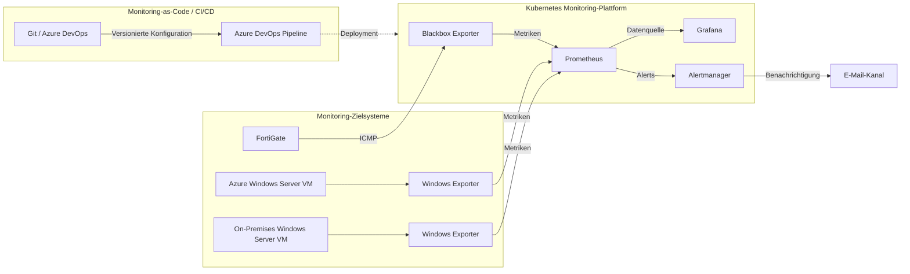

# 03. Architektur & Konzept

---
## Inhaltsverzeichnis
- [03. Architektur \& Konzept](#03-architektur--konzept)
  - [Inhaltsverzeichnis](#inhaltsverzeichnis)
  - [Systemarchitektur](#systemarchitektur)
    - [Komponenten und Verantwortlichkeiten](#komponenten-und-verantwortlichkeiten)
    - [Zusammenspiel der Komponenten](#zusammenspiel-der-komponenten)
    - [Architekturdiagramm](#architekturdiagramm)

---

## Systemarchitektur
Die Monitoring-Plattform wird als Kubernetes-basierter MVP aufgebaut. Die Architektur trennt die zentrale Monitoring-Plattform von den überwachten Zielsystemen. Prometheus übernimmt die zentrale Metrikerfassung, Grafana die Visualisierung und Alertmanager die Verarbeitung von Alarmierungen.

### Komponenten und Verantwortlichkeiten
| Komponente | Verantwortlichkeit |
|---|---|
| Kubernetes | Laufzeitumgebung und Orchestrierung der zentralen Monitoring-Komponenten |
| Prometheus | Erfassung, Speicherung und Abfrage der Monitoring-Metriken |
| Grafana | Visualisierung der durch Prometheus bereitgestellten Metriken |
| Alertmanager | Verarbeitung und Weiterleitung von durch Prometheus ausgelösten Alarmen |
| Blackbox Exporter | Externe Verfügbarkeitsprüfungen, insbesondere ICMP für die FortiGate |
| Windows Exporter | Bereitstellung von Systemmetriken der Windows Server für Prometheus |
| FortiGate | Monitoring-Zielsystem; im MVP primär Überwachung der Erreichbarkeit |
| Azure Windows Server VM | Monitoring-Zielsystem für Windows-Systemmetriken |
| On-Premises Windows Server VM | Monitoring-Zielsystem für Windows-Systemmetriken |
| Git / Azure DevOps | Versionierung der Monitoring-Konfiguration und Grundlage für die spätere automatisierte Bereitstellung |

Die Architektur berücksichtigt damit bereits die zuvor evaluierten Anbindungsvarianten. Für den MVP sind insbesondere der Blackbox Exporter für die FortiGate sowie der Windows Exporter für Windows Server vorgesehen.

Die konkrete Netzwerkkommunikation, Firewallfreigaben und Schnittstellen werden separat im Rahmen von US14 spezifiziert. Ebenso wird die konkrete Ausgestaltung der logischen Mandantentrennung in US15 vertieft.

---

### Zusammenspiel der Komponenten
Die Monitoring-Plattform arbeitet nach dem Pull-Prinzip von Prometheus. Prometheus ruft die bereitgestellten Metriken periodisch von den konfigurierten Monitoring-Zielen beziehungsweise Exportern ab und speichert diese als Zeitreihendaten.

Für den MVP ergeben sich folgende zentrale Abläufe:

1. **Windows Server Monitoring**  
   Der Windows Exporter stellt Systemmetriken der Azure- und On-Premises-Windows-Server bereit. Prometheus ruft diese Metriken ab und speichert sie zentral.

2. **FortiGate Monitoring**  
   Der Blackbox Exporter prüft die Erreichbarkeit der FortiGate mittels ICMP und stellt das Ergebnis als Prometheus-Metrik bereit. Prometheus erfasst diese Metrik wie die übrigen Monitoring-Daten.

3. **Visualisierung**  
   Grafana verwendet Prometheus als Datenquelle und stellt die erfassten Metriken in geeigneten Dashboards dar.

4. **Alarmierung**  
   Prometheus wertet definierte Alert-Regeln aus. Wird eine Bedingung erfüllt, wird der Alarm an Alertmanager übergeben. Alertmanager verarbeitet den Alarm und leitet die Benachrichtigung über den vorgesehenen E-Mail-Kanal weiter.

5. **Monitoring-as-Code und Bereitstellung**  
   Kubernetes-, Prometheus-, Grafana- und Alertmanager-Konfigurationen werden soweit sinnvoll in Git versioniert. Azure DevOps bildet die Grundlage für die spätere automatisierte Bereitstellung der versionierten Konfiguration auf die Kubernetes-Plattform.

Die zentralen Monitoring-Komponenten werden innerhalb der Kubernetes-Plattform betrieben. Die überwachten Zielsysteme bleiben davon getrennt und werden über die jeweils vorgesehene Monitoring-Anbindung integriert.

Die logische Mandantentrennung wird in der Architektur berücksichtigt, ihre konkrete Ausgestaltung wird jedoch im separaten Security- und Mandantentrennungskonzept definiert.

---

### Architekturdiagramm
Das folgende Diagramm zeigt die logische Zielarchitektur des Monitoring-MVP. Die zentralen Monitoring-Komponenten werden auf Kubernetes betrieben. Die Zielsysteme stellen ihre Metriken über die zuvor evaluierten Anbindungsvarianten bereit.

